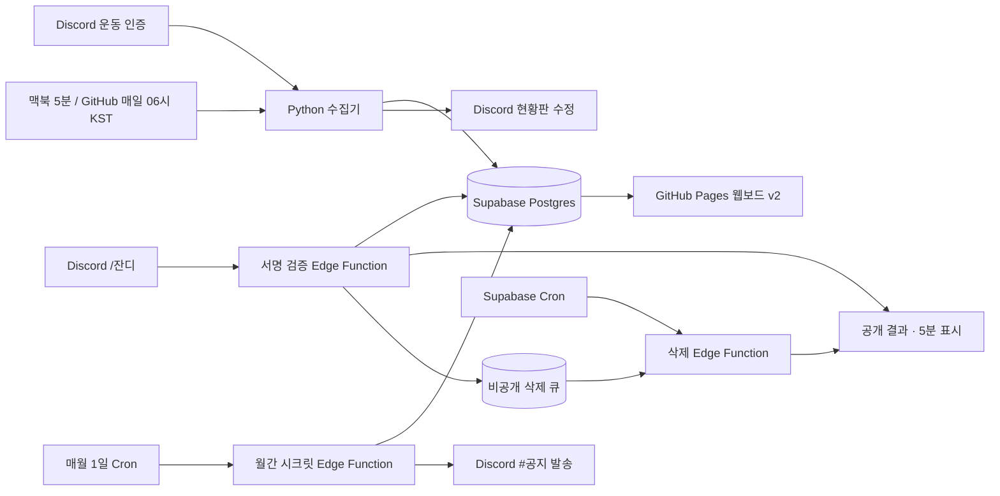

# 고독한 운동가 · 제품 계약과 시스템 설계

제품 동작·데이터·운영 계약은 이 문서에서 관리한다. 시각 디자인과 컴포넌트 기준은 [DESIGN.md](DESIGN.md)를 따른다.

## 1. 목표와 이번 범위

**오늘도 묵묵히, 잔디 한 칸.** Discord에 남긴 운동 인증을 날짜별로 모아 자신과 동료의 꾸준함을 돌아본다. 브랜드는 **고독한 운동가**, 기록을 챙기는 봇은 **묵묵(`mukmuk`)**이다.

사용자가 제시한 `/잔디` 실시간 조회, 현황판 자동 수정, Discord 현황판 14일(슬래시 28일)·웹 달력 연도별 v2 구성을 반영한다. 추가 요구인 **슬래시 결과 표시기간 5분**은 공개 응답을 자동 삭제하는 수명으로 해석한다. 조회할 기록의 기간을 5분으로 줄이는 의미가 아니다.

초기 산출물은 에이전트 지침, 브랜드·화면 설계, 기술 설계, 레포 소개다. Discord 설정은 별도로 진행하며, Supabase 공용 통합과 서울 리전 재생성이 완료됐으며, 기존 `solitary_athlete` 스키마에 묵묵의 데이터 기반을 적용했다. 연결 정책은 [공용 Supabase 통합](#18-공용-supabase-통합-설계)을 따른다.

초기 버전은 한 Discord 서버, 인증 채널 하나, 현황판 채널 하나를 대상으로 한다. 월간 시크릿 코드로 보호된 멤버 전용 웹보드를 사용하며 열람 범위를 참여 전에 알린다. 사진 파일은 Discord에 남기고 첨부 메타데이터만 저장한다. 선택한 기록의 사진은 코드 검증 후 Discord에서 지연 조회한다. 회원 로그인, 여러 서버 운영, 랭킹, 알림, 운동 계획 추천은 초기 범위에 포함하지 않는다.

## 2. 접근 방식

| 방식 | 장점 | 비용·제약 |
| --- | --- | --- |
| **정기 수집 + Edge 조회 + 영속 삭제 큐** | 제안한 Python·Supabase·Pages 구성을 유지하고 함수 종료 후에도 삭제 예약을 보존 | 삭제용 DB 작업과 Cron이 필요, 인증 반영은 수집 주기를 따름 |
| 상시 Discord Gateway 봇 | 인증을 바로 반영하며 명령어와 삭제를 같은 프로세스에서 처리 | 상시 호스팅·재연결·장애 복구 필요, 삭제도 영속 예약이 있어야 재시작에 안전 |
| GitHub Actions에서 조회·삭제까지 처리 | 한 실행 환경으로 모을 수 있음 | 실시간 명령어 응답과 5분 삭제를 만족시키기 어려움 |

첫 번째 방식을 사용한다. 수집 주기와 조회 시점을 분리하고, 5분 삭제만 짧은 주기의 별도 작업으로 처리한다. 기본 수집은 개발 맥북 LaunchAgent의 **5분 달력 예약**이다. Actions는 **매일 06:00 KST(`0 21 * * *` UTC)** 보완 실행과 수동 실행을 사용한다. 예약 실행은 지연되거나 누락될 수 있어 정시 반영을 보장하지 않는다. [GitHub 일정 실행 문서](https://docs.github.com/en/actions/reference/workflows-and-actions/events-that-trigger-workflows#schedule)

## 3. 사용자 경험과 날짜 규칙

| 동작 | 계약 |
| --- | --- |
| 인증 작성 | 일반 사용자 텍스트 또는 사진 첨부를 운동 인증으로 취급. 자동 운동 판별은 하지 않음 |
| 처리 확인 | DB 저장·집계 성공 후 묵묵이 ✅ 추가 |
| `/잔디` | 호출한 본인의 최근 28일 잔디와 최근 기록일 5개의 메모 |
| `/잔디 유저:@멤버` | 선택한 멤버의 같은 정보. 봇 계정은 조회 대상에서 제외 |
| 결과 공개 범위 | 호출 채널 구성원에게 공개. 결과·빈 상태·조회 오류 안내 모두 표시 후 5분 삭제 |
| 현황판 | 전원의 최근 14일 잔디를 요일별 2행(`월 \| 화 \| 수 \| 목 \| 금 \| 토 \| 일`)으로 갱신. 영구 유지하며 자동 수정 |
| 웹 | 선택 연도(평년 365일·윤년 366일) 잔디, 전체 뷰 5대 월간 KPI, 개별 멤버 필터, 날짜별 메모 타임라인, 월간 시크릿 코드 보호 |

### 날짜·집계

- 기록 날짜는 수집 시간이 아니라 **Discord 메시지 작성 시각의 KST 날짜**다. 수정 시에도 날짜는 바꾸지 않는다.
- 현황판의 14일 잔디는 **지난주 일요일부터 이번주 토요일까지의 2주 캘린더 그리드(2행 7열)**다. 헤더 행에 `일 | 월 | 화 | 수 | 목 | 금 | 토`을 명시하여 직관적인 요일 배치를 제공한다. 오늘 이후의 미래 요일은 ⬛(기록 없음)으로 표시한다.
- 웹 잔디는 선택한 연도의 1월 1일부터 12월 31일까지 표시하며, 일요일 시작 행으로 정렬한다. 연도 변경 시 같은 연도의 메모를 조회하고 멤버 선택은 유지한다. 올해의 미래 날짜는 비활성 셀이다. 월간 KPI는 현재 월 기준을 유지한다. 올해의 주간·연속 계산은 연말을 넘는 경우 필요한 이전 연도 기록도 조회하되 연간 합계와 메모에 섞지 않는다.
- **이번 주**는 KST 일요일부터 오늘까지의 서로 다른 인증 날짜 수다. 웹과 Discord 모두 같은 의미를 쓴다.
- **연속**은 오늘 인증이 있으면 오늘부터, 아직 없으면 어제부터 역순으로 센다. 오늘·어제 모두 없으면 0일이다.
- **누적**은 Discord에서 전체 기록 중 서로 다른 날짜 수다. 웹의 연도별 합계는 `2026년 운동`처럼 기간을 명시하며 전체 누적으로 표시하지 않는다.
- 같은 날 복수 인증은 메모를 합치되 운동일은 1일이다. 줄바꿈의 수를 인증 횟수로 해석하지 않는다.
- 잔디 단계는 **0: 기록 없음, 1: 텍스트 인증, 2: 사진 포함 인증**이다. 같은 날 인증 중 Discord 이미지 첨부가 하나라도 있으면 2단계의 진한 녹색을 쓴다. 사진 개수나 인증 횟수로 3단계 이상을 만들지 않는다.
- 사진 단계는 표현에 한 단계 보너스를 주며, 이번 주·연속·누적 운동일을 두 번 세지 않는다. 사진 여부는 원본 이미지 첨부 메타데이터에서 판단하고 메모 문구나 줄바꿈에서 추측하지 않는다. 이미지 링크·영상·문서 첨부는 사진 단계로 올리지 않는다.
- 표시명은 최신 인증 시점의 이름을 사용하고, 서버 닉네임 → 전역 표시명 → 사용자명 순으로 선택한다. 웹의 내림차순 결과를 순회하며 과거 이름으로 덮어쓰지 않는다.
- 현황판·웹 멤버 목록은 기록이 있는 사람만 표시명, 사용자 ID 순으로 정렬한다. `/잔디`로는 기록이 없는 멤버도 조회할 수 있다.

`/잔디`는 요청 순간의 **저장된 데이터**를 조회한다. 새 인증이 다음 수집(맥북 동작 중 약 5분 간격)에 반영되기 전에는 결과에 없을 수 있다. 마지막 수집 성공 시각을 결과와 웹에 표시해 이 차이를 설명한다.

## 4. 구성과 경계

| 경계 | 책임 | 구현 위치 |
| --- | --- | --- |
| 수집기 | 페이지 조회, 원본 저장, 일별 집계, ✅, 14일 2행 현황판 갱신 | `mukmuk/` 및 `main.py` |
| 명령어 등록 | 지정 서버에 `/잔디`와 선택 `유저` 옵션 등록 | `register_cmd.py` |
| Discord 수신 | 서명 검증, 서버 검사, 응답 예약·조회·게시 | `supabase/functions/mukmuk-discord-grass/` |
| 삭제 처리 | 도래한 예약 선점, 원본 응답 삭제, 재시도 | `supabase/functions/mukmuk-discord-cleanup/` |
| 월간 시크릿 발급 | 매월 1일 코드 생성, 24h 유예 기간, `#공지` 채널 메시지 | `supabase/functions/mukmuk-weekly-code/` (`mukmuk-monthly-code`) |
| DB 계약 | 앱 전용 테이블·역할·권한·RPC·Cron 마이그레이션 | `supabase/migrations/` |
| 웹 | 시크릿 인증, 5대 월간 KPI, 1년 잔디, 필터, 메모 타임라인 | `src/` (TypeScript / Vite / Vanilla) |

위 경로는 구현됐다. 실행 방법은 [운영 안내](docs/operations.md)를 따른다. 하나의 파일로 모든 책임을 몰아넣지 않되, 사용하지 않는 추상화나 공통 서비스 계층은 만들지 않는다.

## 5. 데이터 계약

처음 제안된 `(user_id, log_date)` 일별 테이블은 조회에 적합하다. 다만 메모를 읽고 덧붙이는 방식은 재실행 시 중복과 동시 저장 시 유실을 만들 수 있어 **원본 메시지와 공개 일별 집계**를 분리한다.

| 논리 저장소 | 주요 필드·키 | 읽기·쓰기 범위 |
| --- | --- | --- |
| `solitary_athlete.workout_events` | `message_id` PK, `guild_id`, `channel_id`, `user_id`, `username`, 작성·수정 시각, `log_date`, 정리된 `memo`, `has_photo` | 서버 전용 |
| `solitary_athlete.workout_logs` | `(user_id, log_date)` PK, `username`, 순서대로 합친 `memo`, `verification_count`, `has_photo`, 생성·갱신 시각 | 서버 쓰기, `anon` 직접 SELECT 회수 |
| `solitary_athlete.channel_access_secrets` | `id` PK, `secret_code`, `issued_at`, `active_until`, `expires_at` (정규 7일 + 24시간 유예) | 서버 전용 (`mukmuk_worker` 쓰기) |
| `solitary_athlete.get_workout_logs(p_secret_code, p_year)` | RPC 함수. 시크릿 유효성 검증(유예 포함) 후 해당 연도 로그 반환 | `anon` EXECUTE 허용 |
| `solitary_athlete.sync_state` | 인증 채널 커서, 마지막 수집 성공 시각, 현황판 메시지 ID 목록 | 서버 전용. 웹에는 성공 시각만 공개 투영 |
| `solitary_athlete.reply_cleanup_jobs` | `interaction_id` PK, `application_id`, 암호화된 interaction token, 만료 시각, 응답 상태, `published_at`, `delete_after`, 재시도·선점 시각 | 서버 전용 |

원본 이벤트, 큐, 시크릿 테이블은 서버 전용 테이블 권한과 RLS를 적용한다. `workout_logs` 테이블의 직접적인 `anon` 조회 권한은 회수되어 있으며, 오직 RPC 함수 `get_workout_logs`를 통해서만 유효한 시크릿 코드로 인증된 경우에 한해 데이터를 조회할 수 있다.

이벤트 저장과 해당 날짜 재집계는 하나의 DB 트랜잭션으로 수행한다. 기존 이벤트의 같은 `message_id`가 오면 갱신하거나 동일 상태로 종료한다. 집계는 작성 시각·메시지 ID 순으로 만들어 항상 같은 결과를 얻는다. `workout_logs.has_photo`는 그날 원본 이벤트의 사진 여부를 OR 집계한 결과이며, 잔디 단계는 기록 유무와 이 값에서 도출한다. 수정·재집계로 마지막 사진이 없어지면 1단계로 내려간다. ✅ 추가 실패 후 재실행해도 메모나 잔디 단계가 늘어나지 않는다.

### 공개 범위

웹보드는 디스코드 `#공지` 채널에 매주 발급되는 시크릿 코드를 통해 인가된 커뮤니티 멤버에게만 표시명, Discord 사용자 ID, 운동 날짜, 텍스트 메모와 집계를 제공한다. 참여 안내에 이 범위를 적고 개인정보를 메모에 넣지 않도록 안내한다.

## 6. 수집과 현황판

### 수집

1. 최초 실행은 인증 채널의 모든 메시지를 페이지네이션한다. 이후는 마지막 커서 이후 메시지를 페이지네이션해 가져온다.
2. 수집 시작 시 조회 상한 메시지를 고정한다. 모든 페이지를 모아 오래된 메시지부터 처리하고, 실행 도중 새로 온 메시지는 다음 실행에 맡긴다.
3. 봇·시스템 메시지와 빈 인증을 제외한다. 텍스트와 사진 여부를 정리하고 KST 날짜를 계산한다. 사진은 Discord 이미지 첨부를 기준으로 판정한다. `content_type`이 `image/`로 시작하면 사진으로 보고, MIME 정보가 없을 때만 파일 확장자 `.jpg`, `.jpeg`, `.png`, `.webp`, `.gif`, `.heic`, `.avif`를 보조 기준으로 사용한다. 텍스트 없이 사진만 있는 인증도 사진 단계로 기록한다.
4. 메시지 ID로 원자적 저장·집계를 수행한 뒤 ✅를 추가한다.
5. 저장 실패를 넘어 커서를 진행하지 않는다. 저장 성공·리액션 실패 메시지는 다음 실행에서 리액션을 재시도할 수 있도록 비공개 이벤트에 처리 상태를 남긴다.
6. 전체 수집 성공 시 커서와 성공 시각을 갱신한다. Actions는 같은 서버 작업의 중복 실행을 막는 concurrency 그룹을 둔다.

주기마다 최근 28일 메시지도 다시 대조해 수정된 메모를 반영한다. 최초 백필과 겹쳐도 이벤트 ID로 중복을 방지한다. 28일 이전 수정과 Discord 원본 삭제의 자동 전파는 초기 버전 범위 밖이다. 운영자의 명시적인 재집계·삭제 절차로 처리한다.

REST로 읽는 인증 본문·첨부에 Message Content Intent가 필요하므로 개발자 포털 설정과 채널 권한을 구현 단계에 검증한다. [Discord 메시지 문서](https://docs.discord.com/developers/resources/message)

### 현황판

`#잔디`는 일반 멤버 읽기 전용이다. 작성자가 묵묵이고 본문에 **`묵묵 · 운동 잔디 현황`** 표식이 있는 메시지만 현황판 후보로 사용한다. 저장된 ID가 없거나 유효하지 않으면 채널을 페이지네이션해 같은 표식을 찾고, 없으면 새로 작성한다. 사용자는 메시지 ID를 환경변수에 넣지 않는다.

기본은 단일 메시지다. 멤버가 늘어 메시지 내용 한도를 초과하면 표식을 가진 번호별 현황판으로 나눠 수정한다. 줄 또는 멤버 블록을 중간에 잘라 기록을 버리지 않는다. 구성원이 줄면 남는 현황판 메시지를 정리한다. 생성·수정 요청마다 멘션을 비활성화한다. Discord 본문 한도는 구현 시 실제 API 기준으로 확인한다. [Discord 메시지 API](https://docs.discord.com/developers/resources/message#create-message)

## 7. `/잔디` 응답과 5분 삭제

### 요청·표시

Discord 수신 함수는 **원문 본문과 타임스탬프의 Ed25519 서명**을 검증한다. 서명 누락·잘못된 형식·실패는 401로 종료하고, PING은 PONG으로 응답한다. 지정 서버를 검사하며 명령어는 서버에 등록해 DM 사용을 막는다.

3초 안에 초기 응답을 보내야 하므로 정상 명령어는 즉시 공개 defer(`type: 5`, ephemeral 플래그 없음)를 반환한다. 짧은 백그라운드 작업이 비공개 큐 예약을 먼저 저장한 뒤 DB 조회와 원본 응답 수정으로 결과를 표시한다. 결과에는 잔디 범위, 통계, 최근 기록일 5개의 메모, 마지막 수집 시각, **`이 메시지는 5분 뒤 사라져요.`**를 넣는다. 기록이 없거나 DB 조회가 실패한 경우에도 빈 상태와 오류 상태를 구분해 같은 응답을 수정한다. 메모가 길면 최신 기록일 5개는 유지하되 각 메모 미리보기를 줄이고 상세 웹보드로 연결한다. [Discord 응답 규약](https://docs.discord.com/developers/interactions/receiving-and-responding)

### 영속 삭제 예약

결과 표시 성공 시각을 `published_at`으로 기록하고 **`delete_after = published_at + 300초`**로 예약한다. 오류·빈 상태도 같은 규칙을 쓴다. 인증 기록과 현황판은 삭제하지 않는다.

Supabase Cron은 **10초마다** 만료 작업의 존재를 확인하고, 있을 때만 내부 인증을 갖춘 삭제 함수를 호출한다. 초 단위 Cron을 지원하는 Postgres 버전을 배포 전에 확인한다. due 시각 이전에는 삭제하지 않는다. 목표는 정상 상태에서 300초 이후 첫 점검에 삭제 요청을 보내는 것이다. 점검 간격·네트워크·429·장애 때문에 실제 삭제는 늦어질 수 있으며 밀리초 단위의 5분 보장은 하지 않는다. [Supabase Cron](https://supabase.com/docs/guides/cron/quickstart), [예약 함수 호출](https://supabase.com/docs/guides/functions/schedule-functions)

삭제는 `DELETE /webhooks/{application_id}/{interaction_token}/messages/@original`를 사용한다. interaction token은 호출 후 15분 동안 유효하므로 5분 예약과 재시도를 이 안에서 처리한다. 큐의 토큰은 앱 암호화 키로 AES-GCM 암호화하며 익명 읽기·쓰기와 로그 출력을 금지한다. 성공·만료 시 토큰을 제거한다. [Discord 원본 응답 삭제](https://docs.discord.com/developers/interactions/receiving-and-responding#delete-original-interaction-response)

### 상태와 장애 처리

- 예약 상태는 `preparing → scheduled → processing → done`이다. 동일 interaction ID 재전달로 중복 예약을 만들지 않는다.
- 게시 전에는 큐를 저장해야 한다. 큐 저장 실패 때는 정상 결과를 게시하지 않고 로딩 응답을 즉시 정리하며 운영 오류를 기록한다.
- 결과 수정 후 예약 확정 사이에 실패하면 `preparing` 예약을 재확인한다. 원본 응답의 수정 시각으로 표시 시점을 복구하며, 결과가 만들어지지 않은 로딩 응답은 60초 이내 정리를 목표로 한다. 응답 전 작업 자체가 종료된 경우는 운영 관측으로 탐지한다.
- 삭제 작업은 DB에서 원자적으로 선점하고 30초 임대를 둔다. 워커가 종료되면 임대 만료 후 다른 실행이 재시도한다.
- 삭제 API의 204와 이미 삭제된 메시지의 404는 완료로 처리한다. 잘못된 webhook·권한·인증 실패를 메시지 404와 구분한다.
- 429는 `retry_after`를 따르고, 5xx·타임아웃은 만료 전에 제한된 백오프로 재시도한다. 스케줄 도래 전에 재시도를 삭제 성공으로 기록하지 않는다.
- 토큰 만료·지속적인 권한 오류는 `failed`로 기록하고 비밀값을 지운 운영 로그에 남긴다. 큐에는 실패 식별 정보만 보존하며 남아 있는 메시지는 운영자가 정리한다. 서비스가 장시간 중단된 동안의 자동 삭제는 보장할 수 없다.
- 내부 삭제 함수는 Vault에 보관한 `MUKMUK_CLEANUP_SECRET`을 HTTP에 직접 싣지 않고, 타임스탬프·nonce의 HMAC-SHA256 서명으로 호출을 검증한다. 서명 유효기간은 30초다. Discord 수신 함수의 공개 엔드포인트 설정과 분리한다.

함수 내부에서 5분 대기하지 않는다. Edge Functions의 수명 제한은 백그라운드 작업에도 적용된다. 무료 플랜의 문서상 제한은 5분보다 짧다. [Supabase 실행 제한](https://supabase.com/docs/guides/functions/limits), [백그라운드 작업](https://supabase.com/docs/guides/functions/background-tasks)

## 8. 웹과 운영 설정

웹은 공개 읽기용 키로 일별 집계를 조회한다. 서비스 역할 키와 삭제 큐에 접근하지 않는다. 브라우저 내 사용자 텍스트는 HTML로 해석하지 않는다. 바닐라 구현은 `textContent`를 사용하고, React를 선택한 경우 일반 텍스트 렌더링을 사용하며 `dangerouslySetInnerHTML`을 피한다. 조회 실패, 빈 기록, 로딩과 데이터 갱신 중 상태를 각각 구분한다.

운동 기록 셀은 호버·키보드 포커스·터치로 날짜와 메모를 볼 수 있다. 모바일에서도 같은 기능을 제공하며 세부 시안은 [디자인 시스템](DESIGN.md#overview)를 따른다.

설정 이름은 [`.env.example`](.env.example)을 기준으로 한다. Python과 Edge는 앱 전용 DB 연결 `MUKMUK_DATABASE_URL`을 사용하고, 웹은 `SUPABASE_PUBLISHABLE_KEY`와 `solitary_athlete`를 지정한다. 공개 읽기 요청에는 `apikey` 헤더를 사용하고 공개 키를 JWT로 취급하지 않는다. 원격 Secrets는 앱 접두사를 사용한다. 예약용 비밀값은 Vault와 함수 Secrets에, 토큰 암호화 키는 함수 Secrets에 보관한다. 공개 키를 가진 누구나 삭제 작업을 호출할 수 있게 구성하지 않는다.

일반 멤버는 공지·현황판 읽기, 인증·자유수다 쓰기 권한을 갖는다. 봇은 필요한 채널에만 View Channel, Read Message History, Send Messages, Add Reactions를 부여한다. 관리자 전체 권한을 기본 요구로 삼지 않는다.

### 웹 기술 선택

웹 코드는 **TypeScript**를 기본으로 작성한다. 현재의 단일 대시보드, 멤버 필터, 잔디 상세 패널, 메모 페이지네이션은 **바닐라 TypeScript**로 시작한다. 빌드 후 JavaScript·CSS·HTML을 GitHub Pages에 배포한다. 개발용 TypeScript 소스를 브라우저에서 직접 실행하는 방식으로 구성하지 않는다.

로그인·여러 화면·기록 편집·복잡한 폼·여러 컴포넌트가 공유하는 상태가 추가되어 수동 DOM 관리가 복잡해지면 **React + TypeScript**로 전환한다. 단순히 코드가 길어졌다는 이유로 전환하지 않는다. 전환 결정과 이유는 먼저 `DESIGN.md`에 기록한다. 현재는 프레임워크나 빌드 의존성을 설치하는 단계가 아니다.

## 9. 개발 단계와 완료 기준

| 단계 | 구현 범위 | 완료를 판단할 확인 |
| --- | --- | --- |
| 1. 기반 | Discord 4개 채널·권한, Supabase 마이그레이션·RLS·설정 | 익명 집계 SELECT 성공, 익명 쓰기·원본·큐 접근 거부, 가상 인증 저장·집계 확인 |
| 2. 수집 | 페이지 조회·중복 방지·✅·현황판 수정 | 100건 초과 백필, 같은 메시지 재처리, 리액션 실패 복구, 같은 날 복수 인증, 텍스트→사진 단계 상승·사진 제거 재집계·일수 불변, 표시명 변경, 현황판 검색·분할 검증 |
| 3. 명령어·수명 | 서버 명령어 등록·서명 수신·조회·영속 삭제 | PING·서명 오류·3초 defer·본인/타인·빈/오류 응답, 결과 후 300초 이전 유지·이후 삭제, 워커 재시작·429·이미 삭제·토큰 만료 검증 |
| 4. 운영·웹 | Actions 정기·수동 실행, Pages, 필터·잔디·타임라인 | 자동 실행과 중복 실행 방지, DB 전체 통계·메모 페이지, 사진 여부 3단계 범례·상세 표시, TypeScript 빌드·타입 검사, 모바일 터치·키보드 접근, 오류 재시도, 공개 설정만 포함되는지 확인 |

공통 날짜 검증은 KST 자정 직전·직후, 일요일 경계, 오늘 미인증인 연속 기록, 연도 시작 요일·연도 끝·윤년 2월 29일을 포함한다. 5분 삭제는 테스트 서버에서 실제 시각을 측정하고 함수 재시작 후에도 예약이 남는지 확인한다. 정확한 실행 명령은 구현과 함께 정하며, 아직 없는 테스트를 통과했다고 표시하지 않는다.

## 10. 제안 코드에서 보완한 결정

| 제안 코드의 조건 | 설계에 반영한 보완 |
| --- | --- |
| ✅ 유무로만 중복 판정 | 메시지 ID 기반 저장과 리액션 상태 분리 |
| 최신 100개만 조회 | 전체 백필·커서 이후 페이지네이션 |
| 일별 메모 read-append-upsert | 원본 이벤트 + 트랜잭션 일별 집계 |
| 봇의 최신 메시지 수정 | 작성자 + 현황판 표식 + ID 자동 복구 |
| 28칸을 한 줄에 배치 | 7칸씩 네 줄, 조회 범위 명시 |
| 이번 주와 최근 7일 혼용 | 모든 화면을 KST 일요일 기준으로 통일 |
| 84개 셀을 시작 요일 없이 배치 | 요일 행 정렬과 자리표시자 구분 |
| 메모 줄바꿈을 복수 운동으로 해석 | 날짜당 한 칸, 사진 여부로 기본·진한 녹색 두 단계, 횟수는 별도 필드 |
| 전체 기록 limit 500 | 통계와 표시 범위 분리, 상세 메모 페이지네이션 |
| 사용자명을 `innerHTML`에 삽입 | 사용자 텍스트를 `textContent`로 출력 |
| 슬래시 응답 영구 유지 | 공개 응답 + 표시 후 300초 영속 삭제 예약 |

이 설계안은 구현 전에 검토·수정할 수 있는 기준이다. 현재 레포에 기록된 상태를 기능 구현이나 운영 완료로 해석하지 않는다.

## 17. Discord 초기 설정 현황

2026-10-14에 Orca의 로그인된 Discord 브라우저에서 **고독한 운동가** 서버의 채널과 역할을 프로젝트 정체성에 맞게 개편했다. 카테고리를 4개로 구조화하고, 환영 메시지가 공지에 뜨는 문제를 해결하기 위해 `#환영` 채널을 신설하여 시스템 메시지 채널로 지정했으며, 관리자·선생님·회원님 역할을 신설했다. 아울러 커뮤니티 활성화, 기본 알림 `@mentions만`, 이메일 인증 보안 레벨을 적용하고, 초기 최소 기능 원칙(B안)에 따라 기존 `운동-잡담` 채팅 채널을 포럼(Forum) 채널 `#기록실`로 전환했다. 채널명은 직관적이고 기억하기 쉬운 간결한 단일 단어로 정돈했다.

서버 ID: `1559802401802952706` · [서버 열기](https://discord.com/channels/1559802401802952706/1559802402893340744)

### 카테고리 및 채널 구성

| 카테고리 | 채널 | 실제 ID | 일반 멤버 권한 및 역할 |
| --- | --- | --- | --- |
| `📌 안내 및 현황` | [공지](https://discord.com/channels/1559802401802952706/1559802402893340744) | `1559802402893340744` | 채널·기록 읽기 허용, 메시지·스레드·앱 명령어·외부 앱 작성 거부 (순수 소식 및 주요 링크 공지) |
| `📌 안내 및 현황` | [잔디](https://discord.com/channels/1559802401802952706/1559803770744078408) | `1559803770744078408` | 채널·기록 읽기 허용, 메시지·스레드·앱 명령어·외부 앱 작성 거부 (묵묵 14일 현황판 고정) |
| `📌 안내 및 현황` | [규칙](https://discord.com/channels/1559802401802952706/1559859548372598846) | `1559859548372598846` | 공식 커뮤니티 규칙 채널. 채널·기록 읽기 허용, 메시지·스레드 작성 거부 (고독한 운동가의 가치, 채널 안내, 제재 기준 고정) |
| `🏃 운동 기록` | [오운완](https://discord.com/channels/1559802401802952706/1559804769327910932) | `1559804769327910932` | 채널·기록 읽기, 메시지, 사진·파일, 링크, 리액션 허용 (운동 인증 전용, 카테고리 맨 앞 배치) |
| `🏃 운동 기록` | [기록실](https://discord.com/channels/1559802401802952706/1559846944837341245) | `1559846944837341245` | **포럼(Forum)** 채널. 태그 7종: `🎯 목표/다짐`, `🔄 루틴`(형태) + `🏃 운동`, `🍽️ 음식`, `🎮 게임`, `📷 일상`, `✨ 기타`(속성 다중선택, '사진' 태그는 본문 첨부로 일원화하여 제외). 기본 반응: `:mukmuk_grass:`. 이번 연도 또는 기한 없이 목표 달성할 때까지 이어가는 장기 목표·루틴 보관소 (포스팅 시 태그 필수) |
| `☕ 커뮤니티` | [자유](https://discord.com/channels/1559802401802952706/1559839797311438878) | `1559839797311438878` | 채널·기록 읽기, 메시지 쓰기 허용 (일상 자유 잡담 채널, 카테고리 상단 배치) |
| `☕ 커뮤니티` | [환영](https://discord.com/channels/1559802401802952706/1559842103888973915) | `1559842103888973915` | 채널·기록 읽기 허용, 메시지·스레드 작성 거부 (순수 시스템 입장 로그 전용, 알림 피로 방지 및 음소거 적용) |
| `🔊 음성` | 일반 | `1559802402893340745` | 기본 음성 채널 (임시 음성 채널 기능 연동 예정) |
| 관리자 전용 | moderator-only | `1559859548372598849` | Discord 공식 커뮤니티 기능 업데이트 수신 채널 (일반 멤버 비공개, 관리자만 열람) |

* **서버 기본 설정 및 보안**:
  * **커뮤니티 활성화 (Enable Community)**: 포럼 채널 운용 및 커뮤니티 기능 지원을 위해 활성화 완료. 공식 규칙 채널은 `#규칙` (`1559859548372598846`), 커뮤니티 업데이트 채널은 `#moderator-only` (`1559859548372598849`) 지정. 명시적 미디어 콘텐츠 필터(Scan media content from all members) 적용.
  * **기본 알림 설정**: `@mentions만`으로 변경하여 일반 채팅 알림 피로를 방지하고 중요한 공지 및 멘션만 푸시 알림되도록 설정.
  * **보안 수준**: `낮음 (Low)` 설정 (Discord 계정에 인증된 이메일 등록 필수).
  * **시스템 메시지 및 환영 저소음화**:
    * 수신 채널을 `#환영` (`1559842103888973915`)로 지정하여 공지·자유 채팅과 완전 분리.
    * 일반 멤버의 메시지 및 스레드 작성 권한을 거부하여 불필요한 잡담을 방지하고 순수 시스템 로그로 유지.
    * 서버 설정에서 "환영 메시지에 스티커로 답장 유도" 및 "서버 설정 팁 발송"을 꺼서 노이즈를 제거.
    * 채널 알림을 `없음(Nothing)` 및 `채널 음소거(Muted)` 처리하여 중요도와 시각적 노출을 낮춤.
  * **포럼 채널 완성**:
    * `#기록실` 포럼에 가이드라인 문구 등록 ("*이번 연도 목표이거나 기한 없이 달성할 때까지 꾸준히 이어가는 나만의 목표와 루틴을 남기는 공간입니다. 꼭 운동이 아니어도 괜찮습니다. 속성 태그를 함께 달아 자유롭게 기록해보세요.*").
    * 태그 7종 이모지 체계 구축: 형태/목적 태그(`🎯 목표/다짐`, `🔄 루틴`) + 속성 다중선택 태그(`🏃 운동`, `🍽️ 음식`, `🎮 게임`, `📷 일상`, `✨ 기타`). 어색했던 '사진' 태그는 제외.
    * 게시물 작성 시 태그 선택을 필수로 설정하여 주제별 정돈 유지.
    * 기본 반응 이모지로 커스텀 잔디 `:mukmuk_grass:` 지정.
  * **커뮤니티 온보딩 및 서버 가이드 (Server Guide)**:
    * 커뮤니티 활성화 마법사를 완료하여 서버 설정에 `온보딩` 메뉴 승격.
    * **기본 채널**: 전체 공개 채널 8개(`공지`, `잔디`, `규칙`, `오운완`, `기록실`, `자유`, `환영`, `일반`)를 기본 채널로 등록.
    * **맞춤형 설정 질문 (신규 멤버 자동 역할 부여)**: 신규 멤버가 서버에 입장할 때 온보딩 프롬프트를 통해 자동으로 **`회원님`** 역할이 부여되도록 설정 (`"고독한 운동가에 오신 것을 환영합니다."` ➜ `"오늘도 묵묵히, 잔디 한 칸"` 선택 시 `회원님` 역할 ID `1559838647975673987` 자동 지급, 필수 단일 선택).
    * **환영 표지판**: 소유자(`jhoops`) 명의로 슬로건 등록 ("*오늘도 묵묵히, 잔디 한 칸. 조용히 각자의 운동 기록을 쌓아가는 공간입니다.*").
    * **새 멤버가 할 일 (To-Do)**: 3개 태스크 연동 (1. `오늘의 운동 인증하기` ➜ `#오운완` / 2. `14일 잔디 현황 둘러보기` ➜ `#잔디` / 3. `자유롭게 인사 나누기` ➜ `#자유`).
    * **공식 채널 메시지 및 주제 정돈**:
      * **채널별 주제(Topic) 간소화 (해요체)**: 장황했던 초기 설명을 친근하고 담백한 해요체 한 줄로 단축 적용 완료 (`공지`: "주요 소식과 웹보드 링크를 전해요.", `잔디`: "묵묵이 모은 최근 14일 잔디 현황판이에요.", `규칙`: "고독한 운동가의 기본 규칙이에요.", `오운완`: "오늘의 운동 메모나 사진을 남겨요.", `기록실`: "목표, 루틴, 사진을 태그와 함께 기록해요.", `자유`: "가벼운 일상과 대화를 편하게 나눠요.", `환영`: "새로운 회원님의 입장을 기록해요.").
      * `#공지`: 채널별 역할과 `/잔디` 명령어 및 웹보드 링크를 담은 공식 가이드 메시지 유지. 사이드바 최상단에 `서버 가이드` 랜딩 탭 노출 확인.
      * `#규칙`: 고독한 운동가의 기본 규칙(*"잘한 사람보다, 오늘 한 사람이 이깁니다"*), 채널 역할 안내, 경고/타임아웃/퇴장 제재 기준 안내문 게시 완료. 온보딩 [규칙 읽기] 연동.

### 역할(Roles) 구성

| 역할명 | 영문 식별 | 실제 ID | 권한 및 설정 |
| --- | --- | --- | --- |
| **관리자** | Admin | `1559837882691223593` | 관리자(Administrator) 전체 권한, 멤버 분리 표시(Hoist ON), 다크 그린 (`#1f8b4c`) |
| **선생님** | Coach | `1559838471651070062` | 운동 지도 및 모더레이션, 멤버 분리 표시(Hoist ON), 청록 민트 (`#1abc9c`) |
| **회원님** | Member | `1559838647975673987` | 일반 회원 기본 역할 (온보딩 시 자동 부여), 멤버 분리 표시(Hoist ON), 에메랄드 그린 (`#2ecc71`) |
| **묵묵** | Integration / Bot | - | Discord 애플리케이션 설치 시 자동 생성된 전용 통합 역할 (View Channel, Send Messages, Read Message History, Add Reactions). 수동 생성되었던 중복 `묵묵 기록봇` 역할은 삭제 완료. |

Discord 앱·봇 ID는 `1559809751603216444`다. 개발자 포털에서 브랜드 설명과 마크 아바타를 저장하고 **Message Content Intent를 활성화**했다. Presence·Server Members Intent는 사용하지 않는다. `bot`·`applications.commands` 범위로 서버에 설치하고 View Channel·Send Messages·Read Message History·Add Reactions 권한을 허용했다. Python 수집기·Edge 함수가 구현됐고 실제 수집 실행을 확인했다.

서버에도 [마크 PNG](assets/brand/mark.png)를 아이콘으로 적용하고 슬로건을 포함한 소개를 저장했다. 다음 정적 이모지를 등록한 후 설정을 다시 열어 이름·이미지 ID를 확인했다.

| 용도 | 별칭 | 실제 ID | 자산 |
| --- | --- | --- | --- |
| 텍스트 인증 | `mukmuk_grass` | `1560462864618360862` | [기본 잔디 PNG](assets/brand/grass-record.png) |
| 사진 포함 인증 | `mukmuk_photo` | `1560460656829005866` | [사진 잔디 PNG](assets/brand/grass-photo.png) |

로컬 `.env`에 서버·채널·포럼·앱·공개 서명 키·이모지 ID를 기록했다. `.env.example`은 빈 템플릿으로 유지한다. 봇 토큰은 생성·재설정하지 않았고 Interactions Endpoint는 백엔드가 준비되기 전까지 비워 둔다.

완료 범위는 **Discord 채널·포럼·카테고리·역할·서버 설정(커뮤니티/알림/보안/시스템 메시지)·앱 설치·브랜딩**이다. 묵묵 DB 기반은 아래 통합 적용 결과를 따른다. 인증 수집·슬래시·웹보드는 후속 구현·배포됐다. 최신 상태는 아래 릴리스 이력을 따른다.

## 18. 공용 Supabase 통합 설계

### 현재 제약과 진행 순서

공용 프로젝트 통합과 서울 리전 재생성이 완료됐다. 2026-10-14에 로그인된 대시보드와 레포의 공용 전환 기록을 읽어 다음 상태를 확인했다.

- 사용자 운영 이름: `jinhoOps`, 대시보드 프로젝트 이름: **`github-jinhoOps`**.
- 프로젝트 ref: **`olqdftjssrzqvcindekh`**, 리전 **Northeast Asia (Seoul), `ap-northeast-2`**.
- 프로젝트 URL: `https://olqdftjssrzqvcindekh.supabase.co`.
- 앱별 스키마: `individualsavingflow`, `player_one`, **`solitary_athlete`**. 묵묵 스키마에는 아래 5개 테이블이 적용됐다. 운동·운영 데이터는 아직 없다.
- 공용 초기 변경: `supabase/migrations/20261014000001_init_multischema.sql`. 재생성 결과는 [공용 전환 기록](docs/superpowers/specs/2026-10-14-shared-supabase-multischema-design.md)에 남아 있다.
- Data API는 새 테이블 자동 노출 설정이 켜져 있다. 묵묵 마이그레이션은 생성 직후 테이블별 권한을 명시적으로 회수·부여하고 RLS를 활성화해야 한다.

재생성 이전 프로젝트 ref·키·pooler 연결·함수 URL을 재사용하지 않는다. 사용자의 진행 요청에 따라 묵묵 테이블·역할·RLS와 전용 연결을 적용했다. 수집기·함수·Cron·웹은 후속 구현·배포됐다.

독립적으로 진행할 수 있는 Discord 앱·봇 설정, 잔디 이모지, 순수 날짜·잔디 계산, 가상 데이터를 쓰는 TypeScript 웹 화면을 먼저 준비한다. 웹을 가상 데이터로 제공할 때는 `예시 기록`임을 명시한다. 실제 수집·5분 삭제가 되는 것처럼 안내하지 않는다.

### 스키마와 접근 경계

| 구성 | 이름·계약 |
| --- | --- |
| 공개 읽기 | `solitary_athlete.workout_logs`, `solitary_athlete.sync_status` |
| 서버 원본·운영 상태 | `solitary_athlete.workout_events`, `sync_state`, `reply_cleanup_jobs`, 서버 역할만 접근 |
| 객체 소유 역할 | `mukmuk_owner`, 로그인 불가, 묵묵 객체만 소유 |
| 런타임 역할 | `mukmuk_worker`, 로그인 가능, 관리자·역할 생성·DB 생성·RLS 우회 권한 없음 |
| 브라우저 | publishable key, `Accept-Profile: solitary_athlete`, 공개 집계 SELECT만 허용 |
| 수집기·Edge | `MUKMUK_DATABASE_URL`, 전용 역할의 transaction pooler 연결, 앱 객체만 접근 |

공개 테이블에는 RLS와 최소 SELECT 권한을 함께 적용한다. 익명 쓰기와 비공개 원본·큐 접근은 거부한다. `sync_status`에는 마지막 성공 시각만 투영하며, 메시지 커서·현황판 ID·삭제 토큰을 넣지 않는다. 외부 앱의 데이터는 묵묵 공개 응답에 합치지 않는다.

공용 통합에서 준비한 `solitary_athlete`와 노출 목록을 사용한다. 기존 목록을 덮어쓰거나 `public`의 권한·기본 권한을 일괄 변경하지 않는다. 스키마가 노출됐다는 사실은 모든 테이블의 공개 읽기를 뜻하지 않는다. 원본·커서·삭제 큐의 익명·일반 로그인 역할 권한은 명시적으로 거부하며, 테이블별 노출 제어가 제공되는 환경에서는 해당 세 테이블만 추가로 숨긴다. 프로젝트 전체 자동 노출 설정은 다른 앱에 영향을 주므로 임의로 바꾸지 않는다. [Supabase 커스텀 스키마](https://supabase.com/docs/guides/api/using-custom-schemas)

앱마다 별도 secret key를 만들더라도 해당 키의 기본 `service_role` 권한은 프로젝트 범위다. 묵묵은 이를 앱별 데이터 격리로 취급하지 않고 전용 DB 역할을 사용한다. 전용 역할에도 `PUBLIC`을 통해 상속되는 권한이 있을 수 있으므로 통합 프로젝트의 기존 공개 테이블·함수 접근을 확인한다. 필요한 조정은 공용 통합 작업에서 기존 앱의 역할별 권한을 보존하며 해결한다. [Supabase 키 권한](https://supabase.com/docs/guides/getting-started/api-keys), [사용자 정의 역할의 상속 권한](https://supabase.com/docs/guides/troubleshooting/custom-role-inherits-privileges-that-were-not-explicitly-granted-ddaa1c)

transaction pooler의 호스트는 통합 프로젝트 Connect 화면에서 전달받고 리전만 보고 조합하지 않는다. 전용 역할 사용자명은 공용 연결 규약에 따라 프로젝트 ref를 포함한다. 클라이언트는 짧은 트랜잭션과 작은 연결 풀을 사용하고 세션 상태·서버 prepared statement에 의존하지 않는다. [Supabase 연결 방식](https://supabase.com/docs/guides/database/connecting-to-postgres)

### 함수·Cron·Secrets 이름

- Discord 수신 함수: `mukmuk-discord-grass`.
- 삭제 함수: `mukmuk-discord-cleanup`.
- 삭제 Cron: `mukmuk-cleanup-due`, 10초 점검, 도래한 큐가 있을 때만 호출.
- Vault 이름: `mukmuk_project_url`, `mukmuk_cleanup_secret`.
- 원격 Secrets: `MUKMUK_DATABASE_URL`, `MUKMUK_DISCORD_PUBLIC_KEY`, `MUKMUK_REPLY_TOKEN_KEY`, `MUKMUK_CLEANUP_SECRET`. 봇 토큰을 원격 실행에 쓰면 `MUKMUK_DISCORD_BOT_TOKEN`으로 둔다.
- 로컬·GitHub Actions의 Discord 설정 이름은 `.env.example`을 따르고, 원격 함수에서는 위 이름으로 명시적으로 매핑한다.

다른 앱의 동일 이름 함수나 Cron을 재사용하거나 덮어쓰지 않는다. 이미지 원본 저장용 Storage 버킷과 Supabase Auth 설정 변경은 필요하지 않다.

### 배포 이력과 연결 완료 기준

공용 Supabase 프로젝트의 마이그레이션 배포 이력은 한 곳에서 관리한다. 이 레포는 `mukmuk` 이름으로 한정된 변경안을 제공하고 공용 운영 담당자가 전체 이력에 통합한다. 개별 앱 레포가 각각 `supabase db push`를 실행해 공용 이력을 수정하지 않는다.

새 프로젝트 URL은 로컬 설정에 반영했다. publishable key·앱 전용 DB 연결을 새 프로젝트 기준으로 검증했다. 이 프로젝트에는 현재 `supabase_migrations` 테이블이 없고 공용 초기 변경은 SQL Editor로 적용된 상태다. `supabase_vault`는 설치돼 있지만 `pg_cron`·`pg_net`은 아직 설치되지 않았다. 비밀번호를 포함한 연결 문자열이나 비밀값은 설계 문서에 복사하지 않는다.

완료 기준은 공개 집계 읽기, 익명 쓰기 거부, 원본·큐 접근 거부, 전용 역할의 다른 앱 데이터 접근 거부, 기존 앱의 API·작업 정상 유지다. 묵묵 자체의 수집·명령어·삭제 검증은 이 기반 위에서 별도로 진행한다.

실행 순서와 검증 SQL은 [공용 Supabase 연결 계획](docs/superpowers/plans/2026-10-14-shared-supabase-integration.md)에 기록한다. 공용 통합 대기는 해소됐다. 묵묵 DB 기반의 원격 적용과 연결 검증은 완료됐다.

### 2026-10-14 DB 기반 적용 결과

- 적용 파일: [`20261014000002_mukmuk_foundation.sql`](supabase/migrations/20261014000002_mukmuk_foundation.sql). 기존 공용 초기 변경을 재실행하지 않고 로그인된 SQL Editor에서 한 번 적용했다. 번호는 레포의 변경안 번호이며, Supabase CLI 전역 이력에 등록됐다는 뜻은 아니다. 향후 공용 배포 담당 경로에서 수동 적용 이력을 조정한 뒤 CLI 배포한다.
- 원본 `workout_events`, 일별 `workout_logs`, 커서 `sync_state`, 공개 성공 시각 `sync_status`, 삭제 큐 `reply_cleanup_jobs` 5개 모두 RLS가 활성화됐다. 소유자는 NOLOGIN `mukmuk_owner`다.
- `anon`은 `workout_logs`·`sync_status` SELECT만 가능하다. 서버 전용 세 테이블의 익명·일반 로그인·service-role 권한은 없다. worker만 테이블 CRUD를 수행한다. 기존 앱의 권한이나 프로젝트 전체 기본 권한을 바꾸지 않았다.
- Data API 선택 화면에서 서버 전용 세 테이블은 노출되지 않았다. 공개 두 테이블은 **custom grants**로 표시된다. 이를 선택하면 `anon`, `authenticated`, `service_role`의 표준 권한으로 덮어쓴다는 UI 안내가 있으므로 그대로 유지했다. UI의 완전 노출 건수는 4/9이며 공개 두 테이블의 실제 익명 SELECT는 HTTP 200이다. 전용 세 테이블은 HTTP 401·Postgres `42501`로 거부됐다. 익명 쓰기 거부는 실제 로컬 SQL과 원격 ACL로 확인했다.
- `mukmuk_worker`의 LOGIN·연결 제한 3을 적용했다. 관리자·DB/역할 생성·RLS 우회·소유 역할 멤버십·스키마 CREATE 권한이 없다. `player_one`·`individualsavingflow`·`public`의 테이블·보안 정의 함수 접근 권한도 없음을 원격 카탈로그로 확인했다.
- Connect에서 확인한 `aws-0-ap-northeast-2.pooler.supabase.com:6543`으로 전용 계정 연결을 검증했다. `psql`의 클라이언트 연결 정보에서 TLS 1.3을 확인했다. pooler 뒤 DB 세션의 `pg_stat_ssl` 값은 클라이언트 TLS 검사로 사용하지 않는다.
- 관리자 DB 비밀번호를 가져오거나 변경하지 않았다. 전용 비밀번호는 로컬 libpq의 SCRAM-SHA-256 verifier로 바꾸어 서버에 제출했다. 평문은 SQL·공개 문서에 넣지 않고 Git 제외·권한 0600의 `.env`에만 저장했다. [PostgreSQL libpq 비밀번호 처리](https://www.postgresql.org/docs/current/libpq-misc.html#LIBPQ-PQENCRYPTPASSWORDCONN)
- 기존 앱의 `auth.users`, `player_one.profiles`, `public.profiles` 건수는 적용 전후 3/3/3으로 같았다. 사용자 행 내용은 출력하지 않았다. 적용 후 `player_one.profiles`·호환 `public.profiles`의 익명 API도 각각 HTTP 206·전체 건수 3으로 조회됐다.
- 검증: [로컬 SQL 안내](supabase/tests/README.md)의 KST 자정 전후, 사진만 있는 인증, 메시지·운동일 중복, 빈 인증·다른 서버 거부, 300초 삭제 시각, 종료 작업 토큰 제거, 실제 익명 조회·쓰기 거부와 역할 권한이 통과했다. 다른 앱 SELECT를 가상으로 잘못 부여하면 검증이 실패하는 것도 확인했다. 운영 DB에 가상 운동 기록은 넣지 않았다.
- 작업은 기존 Orca checkout을 유지한 `mukmuk/db-foundation` 브랜치에서 진행했다. 로컬 Docker가 응답하지 않아 native PostgreSQL 17 임시 클러스터로 검증했다. 당시 Docker 테스트 컨테이너의 제거는 backend 응답이 없어 확인되지 않았다. 이후 사용자가 Docker를 재실행했고 이번 디자인 정리 마일스톤에서 서버 29.8.2 정상 응답·PostgreSQL 17 전체 회귀 검사 통과와 이전/새 테스트 컨테이너 제거를 확인했다. 계획·에이전트 지침의 위임 제한에 따라 별도 자체 검토를 수행했다. 독립 리뷰·기존 앱의 모든 사용자 시나리오를 실행한 결과는 아니다.

이 DB 기반 검증 이후 수집기·슬래시·삭제 워커·대시보드를 구현하고 GitHub/Edge/Vault 설정을 등록했다. 실제 채팅의 5분 삭제 측정과 자동 테스트 결과는 구분한다.

## 19. 기능 릴리스·main 병합 후 상태

2026-10-14에 [PR #1](https://github.com/jinhoOps/solitary-athlete/pull/1)이 main에 병합됐다. 이후 기준 main은 `3784894`다. 사용자가 변경한 수집 주기는 **매시 59분**이며 최초 설계의 17분으로 되돌리지 않는다.

- [GitHub Pages](https://jinhoops.github.io/solitary-athlete/) 실제 HTTP 200·공개 DB·모바일 화면·배포 SHA를 확인했다. Actions의 Pages artifact 배포를 사용한다.
- Vitest 20개·Chromium 브라우저 10개·Python 9개·SQL 역할/제약·Deno 실제 SQL 큐 검증이 통과했다. main Checks·Pages·수집 수동 실행도 성공했다.
- 수집기·현황판·명령어 등록을 실제 연결로 확인했다. 운영 DB에 가상 운동 인증은 넣지 않았다.
- 기존 관리형 묵묵 역할 `1559812373869760525`에 현황판 View/History/Send만 명시적으로 연결했다. 일반 멤버 읽기 전용을 유지하며 관리자 권한은 추가하지 않았다.
- Edge 두 함수는 플랫폼 JWT 대신 Ed25519/앱 HMAC 서명으로 인증한다. 삭제 함수는 비인증 401·앱 인증 200과 실제 전용 DB 연결을 확인했다.
- `pg_cron`·`pg_net`을 활성화하고 앱 전용 Vault 두 개와 [Cron 마이그레이션](supabase/migrations/20261014000003_mukmuk_cleanup_cron.sql)을 적용했다. 앱 dispatch 함수는 SECURITY INVOKER이며 worker/anon 실행을 허용하지 않는다. 10초 due 점검과 앱 Cron 이력만 7일 보존하는 작업이 활성화됐다.
- 별도 코드 리뷰의 게시/복구 경합·transient 게시 재시도·삭제 처리량 지적을 보완했다. 45초 게시 임대, 세 번의 제한된 게시 재시도, 30초 삭제 임대와 attempts fencing, 실행당 50건/약 20초 큐 처리를 적용했다. 함수 내부의 5분 대기는 없다.
- 실제 `/잔디` 결과는 사용자 호출로 게시됐다. 20:55:35→21:00:35의 300초 예약과 기한 전 공개 메시지 유지를 확인했다. 21:00:44에 삭제 완료·토큰 제거를 관측하고 Discord 메시지 부재·현황판 보존을 확인했다. 운영·검증 상세는 [운영 안내](docs/operations.md)와 [구현 현황](docs/implementation-readiness.md)을 따른다.

### 공용 HTTP 큐의 내부 인증 보완

권한 점검에서 `net.http_request_queue`를 anon과 앱 worker도 읽을 수 있음을 확인했다. 프로젝트 전역 ACL을 변경하지 않고 [마이그레이션 00004](supabase/migrations/20261014000004_mukmuk_signed_cleanup.sql)로 묵묵 dispatch 함수만 교체한다. 재사용 가능한 비밀값은 Vault/Edge에 보관하고 HTTP에는 30초 HMAC 서명·시각·nonce만 전송한다. 묵묵 내부 키를 교체하며 다른 앱 키는 건드리지 않는다. SQL HMAC와 별도 Python 계산의 일치, 변조·만료·미래 시각·기존 원문 비밀값 거부를 검증한다.

### 주간 코드 안내 수명 및 배포 보완 (2026-10-14)

주간 발급 함수와 Cron(`0 15 * * 0` UTC)을 실제 배포했다. 주중 최초 발급도 다음 KST 월요일 00시에 전환하며 기존 코드 유예는 전환 이후 24시간이다. 안내 메시지는 다음 발급의 새 안내 전송이 성공한 뒤 삭제한다. 현재 코드에 대한 재호출은 기존 안내를 재사용하고, 삭제 대상은 공지 채널의 묵묵 작성 안내로 한정한다.

앱 역할의 코드 테이블 SELECT/INSERT RLS 정책과 serial 시퀀스 USAGE 누락을 보완했다. 트랜잭션 advisory lock으로 활성 코드의 동시 중복 발급을 방지한다. 예약 호출 HTTP 응답은 메시지 ID와 기한만 포함하며 코드가 공용 전송 응답 테이블에 남지 않는다. 원격 최초 발급, 코드 RPC, Vault/pg_net 호출 200 및 공지 한 개 유지 확인은 운영 안내에 기록했다.

### 맥북 기본 수집·GitHub 일일 보완 수집 (2026-10-15)

GitHub 예약은 10월 15일 01:09·05:22·08:32 KST에만 생성돼 매시간 수집 간격을 지키지 못했다. 사용자 결정으로 로컬 LaunchAgent의 5분 예약을 기본으로 하고 GitHub는 매일 06:00 KST 보완으로 전환한다. 기존 59분 설정 유지 지침은 이 결정으로 대체된다.

수집기 전체는 별도 연결의 transaction advisory lock으로 직렬화한다. Supavisor transaction pooling에서도 잠금을 가진 트랜잭션을 유지하며 메시지별 저장 연결은 별도로 사용한다. 중복 실행은 건너뛰고 프로세스 종료 시 잠금이 풀린다. 로컬 실행기는 240초 제한과 프로세스 그룹 종료를 적용한다. 서버 슬래시·300초 삭제·주간 코드 Cron은 기존 Supabase 배치를 유지한다.

## 2026-10-15 연간 합산 그래프와 운동왕 계약

- 전체 화면은 멤버별 카드를 나열하지 않고 일별 고유 인증 인원을 단일 그래프에 합친다. 분모 N은 전체 인증 이력의 고유 사용자 수이며 연도와 무관하다. 농도는 N>0이면 min(k,50)/min(N,50), 0명이면 0이다. 50명을 넘어도 상세 인원은 정확히 보존한다. 사진은 개인 단계와 전체 상세에서만 구분한다.
- `get_dashboard_members(text,text,integer)`는 인증된 전체 멤버 목록을 ID 오름차순 cursor로 200명씩 조회한다. 표시명은 최신 기록의 이름이다. `get_workout_logs_page(text,integer,date,text,integer)`는 연도 기록을 날짜 내림차순·ID 오름차순 cursor로 500행씩 조회한다. 기존 get_workout_logs는 호환을 위해 유지한다.
- 두 RPC 모두 solitary_athlete 스키마와 mukmuk_owner 소유권, 고정 빈 search_path, 코드 만료 검사를 사용한다. 익명 테이블 직접 읽기를 열지 않는다. 클라이언트는 마지막 페이지까지 읽고 중간 실패·cursor 역행을 완성된 데이터로 표시하지 않는다.
- 운동왕은 KST 현재 월 1일~오늘의 최대 고유 운동일수로 계산한다. 사진·여러 인증은 하루 1일, 동률 전원의 닉네임만 표시하며 첫 KPI다. ID·일수는 내부 선정과 동명이인 구분에만 사용한다. 연간 그래프를 과거로 바꿔도 현재 월 KPI를 조회한다.
- 사용자 요청으로 그래프 행과 이번 주 통계 모두 일요일 시작으로 통일한다. 주간 시크릿 코드의 월요일 발급 일정은 유지한다. 주간 경계 변경은 웹·Python 현황판·공유 dates.ts를 사용하는 Discord 함수에 함께 반영한다.

### 2026-10-16 묵묵 봇 프로필

사용자 요청에 따라 승인 시트에서 분리한 `assets/brand/mukmuk/profile/mukmuk-profile-512.png`를 Discord 묵묵 봇 프로필에 적용했다. 봇 사용자 ID를 앱 ID와 대조한 뒤 아바타만 수정하고 재조회했다. 고독한 운동가 서버의 새싹 아이콘은 전후 해시가 동일함을 확인했다. 공용 mark·banner는 새싹을 유지하며 마스코트 mark·banner는 mukmuk 폴더 안의 봇 전용 에셋이다.

### 2026-10-16 Discord 앱 이미지 반영

최종 브랜드 파일을 실제 Discord에 적용했다. 앱 아이콘은 `assets/brand/mukmuk/profile/mukmuk-profile-1024.png`, 봇 아바타는 같은 정면의 512px PNG를 사용한다. 앱 커버(`cover_image`)와 봇 프로필 배너(`banner`)에는 하단 묵묵을 80px로 축소·좌우 반전하고 소개 문구를 400 굵기로 조정한 `assets/brand/banner.png`를 적용했다. 앱 ID와 봇 사용자 ID를 대조하고 이미지 필드만 수정했다. API 재조회와 네 이미지의 CDN HTTP 200 응답을 확인했다. 고독한 운동가 서버 아이콘은 변경 전후 동일함을 검증했다.

### 2026-10-16 월간 시크릿 코드 전환

사용자 요청에 따라 주간 시크릿 코드를 매월 1일 갱신되는 월간 시크릿 코드로 전면 전환했다.
- **발급 주기 및 유효기간**: `activeUntil`을 다음 달 1일 00:00 KST, `expiresAt`을 그로부터 24시간 뒤로 설정하여 24시간 유예 기간을 유지한다.
- **Discord 공지**: `#공지` 채널 문구를 `## 🔑 이번 달 웹보드 시크릿 코드` 및 `매월 1일 새로운 코드가 발급됩니다.`로 변경했다. 봇이 새 공지를 게시한 뒤 이전 주간/월간 공지 메시지를 모두 정리한다.
- **웹 대시보드**: 모달 입력 안내 문구를 `이번 달 시크릿 코드`로 갱신했다.
- **Edge Functions 및 Cron**: 매일 15:00 UTC (= 00:00 KST)에 실행되어 KST 1일인 경우만 디스패치하는 `solitary_athlete.mukmuk_dispatch_monthly_code()` 및 `mukmuk-monthly-code` cron(`0 15 * * *`)을 구성했다. 기존 `mukmuk-weekly-code` 함수와 내부 서명(`mukmuk-monthly-code-v1` 및 `mukmuk-weekly-code-v1`)의 상호 호환성을 유지한다.

## 2026-10-16 Discord 사진 지연 조회 계획

상태: PR #11 main 병합, 운영 DB·Edge·맥북 수집기·Pages 배포와 실제 사진 지연 조회 검증 완료. 실행 이력은 운영 안내에서 관리한다.

- 사진 원본·썸네일 파일은 Discord에만 둔다. Supabase Storage, 저장소, 서비스 워커에 이미지 복사본을 보관하지 않는다. DB에는 메시지·채널·첨부 ID, 파일명, MIME, 크기 등 메타데이터만 저장한다.
- 첫 접속·코드 입력·멤버/연도 변경·잔디 렌더링에는 사진 바이너리 요청을 발생시키지 않는다. 사진 링크 갱신도 화면 전체에 대해 선행하지 않는다.
- 사용자가 날짜/기록 상세를 열 때 해당 범위의 사진 정보를 요청한다. 전체 멤버 상세는 멤버별 사진 보기 버튼으로 조회를 시작하며 이미지가 화면에 들어올 때만 로딩한다. 클릭한 이미지에 대해서만 큰 이미지를 받는다.
- 전용 Edge 함수는 매 요청에 기존 월간 코드 유효성을 검증하고 허용된 서버·채널·저장된 메시지/첨부 ID만 조회한다. 클라이언트가 보낸 임의 URL은 가져오지 않는다. 봇 토큰은 서버에만 둔다. 월간 코드는 개별 Discord 멤버십 인증은 아니다.
- 동일 메시지의 첨부는 메시지 한 번 조회로 해결한다. 사진 조회 한 페이지는 최대 3개 원본 메시지이며 추가 페이지는 사진 더 보기로 요청한다. 메시지당 서버 제한 10초, 브라우저의 페이지 요청 제한은 45초다. 권한 확인 후 재사용하는 링크 메타데이터 캐시는 서명 만료 전 안전 여유를 두고 종료하며 코드 만료를 우회하지 않는다. 중복 요청을 합치고 Discord 429의 retry_after와 제한된 동시 요청을 처리한다.
- Discord Media Proxy 축소 응답을 실제 파일의 크기·포맷·모바일 응답으로 먼저 검증한다. 지원이 확인된 경우만 미리보기에 사용한다. CSS 축소만으로 전송량이 줄었다고 간주하지 않는다. 축소 실패 시 원본을 자동 로딩하지 않고 사진 보기 버튼을 제공한다.
- 원본/첨부 삭제가 확정되면 첨부 메타데이터를 비활성화하고 웹에서도 숨긴다. 403·429·5xx·타임아웃은 삭제로 간주하지 않는다. 사진 열람 실패로 운동일·메모·잔디 집계를 삭제하지 않는다.
- 브라우저 HTTP 캐시에 받은 사진이 일시적으로 남을 수 있으나 보존을 보장하지 않는다. 삭제 반영은 다음 원본 확인 시점이며 실시간 삭제나 CDN 캐시 즉시 제거를 보장하지 않는다. CDN 서명 링크는 유효 기간 중 전달될 수 있다.
- 과거 사진 메타데이터 백필은 페이지네이션·message_id 멱등성을 유지하고 수집 커서나 기존 메모를 훼손하지 않는다.

참고: [서명 링크](https://github.com/discord/discord-api-docs/blob/main/developers/reference.mdx#signed-attachment-cdn-urls), [첨부 객체](https://github.com/discord/discord-api-docs/blob/main/developers/resources/message.mdx#attachment-object).

## 2026-10-16 인증 원본 삭제 반영 설계

상태: 수동 갱신 구현·로컬 검증 완료. 운영 적용 이력은 운영 안내를 따른다. 사용자 결정으로 과거 이력의 자동 순환 점검을 하지 않고 **슬래시로 지정한 멤버만 수동 점검**한다. 기존 6절의 삭제 자동 전파 제외 방침은 이 수동 경로를 추가하는 것으로 보완하며 `/잔디` 결과의 300초 삭제와 구분한다.

### 명령과 처리 범위

- `/기록갱신 유저:@멤버`: 해당 서버에 저장된 대상 멤버의 인증만 확인한다. `유저`는 선택이며 생략하면 호출자 본인을 대상으로 한다. 전체 멤버 일괄 정리 옵션은 제공하지 않는다.
- `회원님` 역할의 일반 멤버는 본인 기록만 실행/상태 조회할 수 있다. 다른 멤버를 선택하면 서버에서 거부하며 작업을 만들거나 조회하지 않는다. 서버 관리(MANAGE_GUILD) 또는 관리자(ADMINISTRATOR)는 본인·다른 멤버를 지정할 수 있다. 회원님 여부는 역할 이름이 아닌 설정된 역할 ID로 검사한다. 어느 조건도 충족하지 못하는 호출자, 다른 서버·DM·봇 대상은 거부한다.
- 명령 등록 시 관리자 전용 권한으로 숨기지 않는다. Discord 화면의 표시/선택 제한에 의존하지 않고 서명된 interaction의 실제 호출자 ID·역할·권한과 대상 ID를 대조한다. 상태 조회에도 같은 규칙을 적용한다.
- 명령을 호출하지 않으면 정리용 원본 조회는 **0건**이다. 기존 최근 28일 수정 수집은 그대로 유지하되 자동 누락 대조·과거 순환 점검은 추가하지 않는다.
- 접수 시 대상 멤버의 최대 저장 메시지 ID를 상한으로 고정한다. 그 시점까지의 저장 이벤트를 ID 순서로 페이지 조회하며 새 인증은 이번 정리에서 제외한다. 채널 전체 메시지 이력을 다시 읽지 않고 저장된 원본 ID만 개별 조회한다.
- 실제 작업은 비공개 영속 큐에 넣고 기존 5분 수집기가 처리한다. 접수 응답은 즉시 반환하며 다음 수집 실행부터 진행된다. 맥북이 쉬는 동안은 대기하고 일일 GitHub 보완 수집도 같은 큐를 처리할 수 있다. 별도 상시 프로세스·Cron을 추가하지 않는다.
- 실행당 한 작업의 최대 20개 메시지·최대 30초만 처리하고 나머지는 다음 실행으로 넘긴다. 여러 작업은 최근 처리 시각 순으로 공정하게 나눠 진행한다. 100건이면 최소 5번의 성공 실행이 필요하며 네트워크·절전 때문에 더 늦어질 수 있다.
- 동일 멤버의 진행 중 작업은 재사용하고 진행 상황을 보여준다. 같은 interaction 재전송도 중복 접수하지 않는다. 별도의 상태 옵션은 제공하지 않으며 완료된 뒤 새 호출은 새 점검을 접수한다.
- 접수/상태 응답은 호출자에게만 표시하고 기존 300초 삭제 처리와 연계한다. 장시간 작업의 결과를 15분 interaction token으로 나중에 전송하려 하지 않는다. 완료 결과는 비공개 DB에 남겨 상태 조회로 확인한다. DM이나 채널 자동 완료 알림은 추가하지 않는다.

### 삭제 확정과 결과

봇의 VIEW_CHANNEL/READ_MESSAGE_HISTORY 실효 권한(서버 역할·관리자·채널 덮어쓰기 포함)을 확인한다. Discord는 READ_MESSAGE_HISTORY가 없으면 목록 조회가 HTTP200/빈 배열일 수 있으므로 빈 목록은 삭제 증거가 아니다. 호출자의 현재 회원 역할/관리 권한과 본인 대상 여부도 실제 작업 선점 시 같은 규칙으로 재확인한다. 접수 후 탈퇴하거나 필요한 역할/권한을 잃었으면 기록을 보존하고 작업을 중단한다.

원본 개별 GET의 **HTTP404 + Discord10008(Unknown Message)**만 삭제로 확정한다. 코드 없는404·10003(Unknown Channel)·401·403·429·5xx·타임아웃·CDN 오류는 취소 근거가 아니다. DB에서 제거하기 직전에도 채널 권한을 확인한다. HTTP200 원본은 기존 정규화·저장 경로로 최신 수정과 사진 제거를 반영한다.

| 확인 결과 | 반영 |
| --- | --- |
| 유일한 인증 삭제 | 해당 일별 잔디·메모 제거, 운동일수·스트릭·운동왕 재계산 |
| 같은 날 여러 인증 중 하나 삭제 | 그 메시지의 내용만 제거, 남은 인증으로 하루 한 칸 유지 |
| 마지막 사진 인증 삭제, 텍스트 인증 유지 | 기본 녹색으로 변경 |
| 사진만 제거하고 텍스트 유지 | 텍스트 유지·사진 단계 해제 |
| 유효한 원본 유지 | 메모·첨부 정보를 최신 상태로 갱신 |
| 일시적인 조회 오류 | 기록을 유지하고 해당 위치부터 다음 실행에 재시도 |

전체 그래프의 고유 인증/사진 인원과 월간 KPI도 남은 집계로 계산한다. 마지막 인증을 잃은 멤버가 인증 이력 기반 목록에서 빠지면 전체 그래프의 분모도 바뀔 수 있다. 이미 열린 웹은 다음 조회/새로고침에, 현황판은 다음 성공 갱신에, `/잔디`는 다음 호출부터 반영한다. 기존 슬래시 응답 일괄 수정이나 브라우저 이미지 캐시 즉시 소거는 보장하지 않는다.

### 큐·재처리 안전성

서버 전용 `workout_reconcile_jobs`에 interaction ID, 요청자/대상 ID, 채널·서버, 상한 메시지 ID, 처리 커서, 상태, 점검/수정/삭제 건수, 재시도 시각·오류 코드·임대 정보를 저장한다. 앱 소유권·RLS·전용 역할을 따르며 익명 접근을 열지 않는다. 원문 메모·사진 URL·interaction token은 작업 큐에 저장하지 않는다. 기존 응답 삭제 큐의 암호화 token과 책임을 섞지 않는다.

작업은 기존 수집 잠금 아래 선점하며 임대와 시도 번호로 오래된 실행의 커서 갱신을 막는다. 이벤트 저장/제거·일별 재집계·성공 커서·누적 건수는 메시지별 같은 트랜잭션으로 확정해 재시도 시 중복 집계하지 않는다. 현재 Store.save의 트랜잭션 경로를 확장하며 큐 상태 때문에 기존 수집 커서를 이동하지 않는다.

429는 retry_after까지 작업을 보류하고 추가 조회를 멈춘다. 원본 조회는 남은 30초 예산 이내의 단일 시도이며 긴 내부 재시도를 사용하지 않는다. 계속된 권한/채널 오류는 failed로 종료하고 원본은 보존한다. 일시 오류가 10회 연속 이어져도 failed로 종료해 무한 재시도를 막는다. failed 작업은 상태 조회에서 확인하고 권한이 있는 호출자가 새 명령으로 다시 점검한다. 성공적으로 처리한 앞부분은 롤백하지 않으며 부분 완료 건수를 보여준다.

명령을 사용하지 않은 대상은 건드리지 않는다. 사진 Edge는 사진 표시만 비활성화하며 인증 취소의 별도 진입점으로 사용하지 않는다. 수집·현황판·집계 기본 동작과 맥북 240초 전체 제한을 유지한다.

근거: [Discord 메시지 조회와 권한](https://github.com/discord/discord-api-docs/blob/main/developers/resources/message.mdx#get-channel-messages), [Discord 오류 코드](https://github.com/discord/discord-api-docs/blob/main/developers/topics/opcodes-and-status-codes.mdx#json-json-error-codes).
