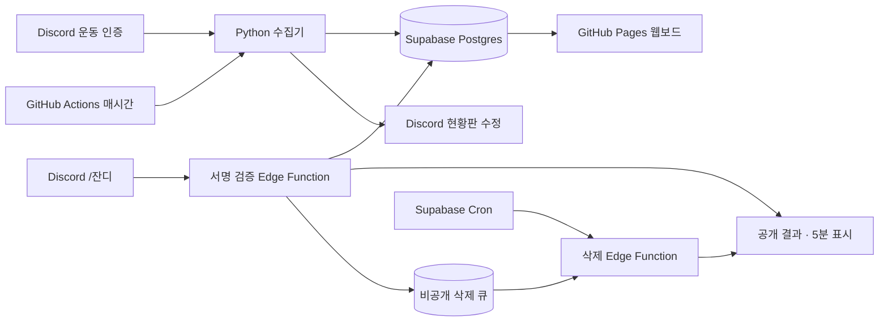

# 고독한 운동가 · DESIGN

작성·갱신: 2026-10-14 · 상태: **구현 전 설계안**

제품·시스템·브랜드·화면 설계의 기준 문서는 루트 `DESIGN.md`다. 요구사항과 화면이 바뀌면 이 문서와 관련 시안을 함께 갱신한다. 설계를 별도 경로에 중복 관리하지 않는다.

## 1. 목표와 이번 범위

**오늘도 묵묵히, 잔디 한 칸.** Discord에 남긴 운동 인증을 날짜별로 모아 자신과 동료의 꾸준함을 돌아본다. 브랜드는 **고독한 운동가**, 기록을 챙기는 봇은 **묵묵(`mukmuk`)**이다.

사용자가 제시한 `/잔디` 실시간 조회, 현황판 자동 수정, Discord 28일·웹 84일 구성을 유지한다. 추가 요구인 **슬래시 결과 표시기간 5분**은 공개 응답을 자동 삭제하는 수명으로 해석한다. 조회할 기록의 기간을 5분으로 줄이는 의미가 아니다.

초기 산출물은 에이전트 지침, 브랜드·화면 설계, 기술 설계, 레포 소개다. Discord 설정은 별도로 진행하며, Supabase 공용 통합과 서울 리전 재생성이 완료됐으며, 기존 `solitary_athlete` 스키마를 기준으로 묵묵의 설계·연결 계획을 준비한다. 연결 정책은 [공용 Supabase 통합](#18-공용-supabase-통합-설계)을 따른다.

초기 버전은 한 Discord 서버, 인증 채널 하나, 현황판 채널 하나를 대상으로 한다. 공개 웹보드를 사용하며 인증 텍스트가 웹에 공개됨을 참여 전에 알린다. 사진 파일은 Discord에 남기고 웹에는 사진 인증 여부만 기록한다. 회원 로그인, 여러 서버 운영, 랭킹, 알림, 운동 계획 추천은 초기 범위에 포함하지 않는다.

## 2. 접근 방식

| 방식 | 장점 | 비용·제약 |
| --- | --- | --- |
| **정기 수집 + Edge 조회 + 영속 삭제 큐** | 제안한 Python·Supabase·Pages 구성을 유지하고 함수 종료 후에도 삭제 예약을 보존 | 삭제용 DB 작업과 Cron이 필요, 인증 반영은 수집 주기를 따름 |
| 상시 Discord Gateway 봇 | 인증을 바로 반영하며 명령어와 삭제를 같은 프로세스에서 처리 | 상시 호스팅·재연결·장애 복구 필요, 삭제도 영속 예약이 있어야 재시작에 안전 |
| GitHub Actions에서 조회·삭제까지 처리 | 한 실행 환경으로 모을 수 있음 | 실시간 명령어 응답과 5분 삭제를 만족시키기 어려움 |

첫 번째 방식을 제안한다. 수집 주기와 조회 시점을 분리하고, 5분 삭제만 짧은 주기의 별도 작업으로 처리한다. Actions는 정각 혼잡을 피한 **매시 17분(`17 * * * *`)** 실행과 수동 실행을 사용한다. 예약 실행은 지연되거나 누락될 수 있어 정시 반영을 보장하지 않는다. [GitHub 일정 실행 문서](https://docs.github.com/en/actions/reference/workflows-and-actions/events-that-trigger-workflows#schedule)

## 3. 사용자 경험과 날짜 규칙

| 동작 | 계약 |
| --- | --- |
| 인증 작성 | 일반 사용자 텍스트 또는 사진 첨부를 운동 인증으로 취급. 자동 운동 판별은 하지 않음 |
| 처리 확인 | DB 저장·집계 성공 후 묵묵이 ✅ 추가 |
| `/잔디` | 호출한 본인의 최근 28일 잔디와 최근 기록일 5개의 메모 |
| `/잔디 유저:@멤버` | 선택한 멤버의 같은 정보. 봇 계정은 조회 대상에서 제외 |
| 결과 공개 범위 | 호출 채널 구성원에게 공개. 결과·빈 상태·조회 오류 안내 모두 표시 후 5분 삭제 |
| 현황판 | 전원의 최근 28일 잔디와 이번 주·누적 운동일. 영구 유지하며 자동 수정 |
| 웹 | 최근 84일 잔디, 전체·멤버 필터, 이번 주·연속·누적 운동일, 날짜별 메모 |

### 날짜·집계

- 기록 날짜는 수집 시간이 아니라 **Discord 메시지 작성 시각의 KST 날짜**다. 수정 시에도 날짜는 바꾸지 않는다.
- 오늘 포함 과거 27일 = 28일, 오늘 포함 과거 83일 = 84일. 날짜 오름차순으로 보여준다.
- 28일 잔디는 고정 요일 달력이 아닌 **오래된 날부터 7개씩 묶은 네 줄**이다. 시작·종료 날짜를 표시한다.
- 84일은 정확히 84칸이다. 월요일부터 일요일 행에 맞추기 위해 앞뒤에 비기록 자리표시자가 최대 6칸씩 생기며, 일부 구간은 13개 주 열에 걸친다. 자리표시자는 날짜나 운동일로 세지 않는다.
- **이번 주**는 KST 월요일부터 오늘까지의 서로 다른 인증 날짜 수다. 웹과 Discord 모두 같은 의미를 쓴다.
- **연속**은 오늘 인증이 있으면 오늘부터, 아직 없으면 어제부터 역순으로 센다. 오늘·어제 모두 없으면 0일이다.
- **누적**은 전체 기록 중 서로 다른 날짜 수다. 84일 표시 범위나 최근 메모 페이지 수로 누적을 계산하지 않는다.
- 같은 날 복수 인증은 메모를 합치되 운동일은 1일이다. 줄바꿈의 수를 인증 횟수로 해석하지 않는다.
- 잔디 단계는 **0: 기록 없음, 1: 텍스트 인증, 2: 사진 포함 인증**이다. 같은 날 인증 중 Discord 이미지 첨부가 하나라도 있으면 2단계의 진한 녹색을 쓴다. 사진 개수나 인증 횟수로 3단계 이상을 만들지 않는다.
- 사진 단계는 표현에 한 단계 보너스를 주며, 이번 주·연속·누적 운동일을 두 번 세지 않는다. 사진 여부는 원본 이미지 첨부 메타데이터에서 판단하고 메모 문구나 줄바꿈에서 추측하지 않는다. 이미지 링크·영상·문서 첨부는 사진 단계로 올리지 않는다.
- 표시명은 최신 인증 시점의 이름을 사용하고, 서버 닉네임 → 전역 표시명 → 사용자명 순으로 선택한다. 웹의 내림차순 결과를 순회하며 과거 이름으로 덮어쓰지 않는다.
- 현황판·웹 멤버 목록은 기록이 있는 사람만 표시명, 사용자 ID 순으로 정렬한다. `/잔디`로는 기록이 없는 멤버도 조회할 수 있다.

`/잔디`는 요청 순간의 **저장된 데이터**를 조회한다. 새 인증이 매시간 수집되기 전에는 결과에 없을 수 있다. 마지막 수집 성공 시각을 결과와 웹에 표시해 이 차이를 설명한다.

## 4. 구성과 경계



| 경계 | 책임 | 구현 예정 위치 |
| --- | --- | --- |
| 수집기 | 페이지 조회, 원본 저장, 일별 집계, ✅, 현황판 갱신 | `main.py`와 필요한 소규모 모듈 |
| 명령어 등록 | 지정 서버에 `/잔디`와 선택 `유저` 옵션 등록 | `register_cmd.py` |
| Discord 수신 | 서명 검증, 서버 검사, 응답 예약·조회·게시 | `supabase/functions/mukmuk-discord-grass/` |
| 삭제 처리 | 도래한 예약 선점, 원본 응답 삭제, 재시도 | `supabase/functions/mukmuk-discord-cleanup/` |
| DB 계약 | 앱 전용 테이블·역할·권한·Cron의 검토된 변경안 | `mukmuk` 전용 마이그레이션, 공용 프로젝트의 단일 배포 이력 |
| 웹 | 공개 읽기, 필터, 잔디, 통계, 메모 탐색 | 루트 `index.html` + `src/`의 TypeScript·CSS, 빌드한 정적 자산 |

위 경로는 아직 생성되지 않은 구현 예정 경로다. 하나의 파일로 모든 책임을 몰아넣지 않되, 사용하지 않는 추상화나 공통 서비스 계층은 만들지 않는다.

## 5. 데이터 계약

처음 제안된 `(user_id, log_date)` 일별 테이블은 조회에 적합하다. 다만 메모를 읽고 덧붙이는 방식은 재실행 시 중복과 동시 저장 시 유실을 만들 수 있어 **원본 메시지와 공개 일별 집계**를 분리한다.

| 논리 저장소 | 주요 필드·키 | 읽기·쓰기 범위 |
| --- | --- | --- |
| `solitary_athlete.workout_events` | `message_id` PK, `guild_id`, `channel_id`, `user_id`, `username`, 작성·수정 시각, `log_date`, 정리된 `memo`, `has_photo` | 서버 전용 |
| `solitary_athlete.workout_logs` | `(user_id, log_date)` PK, `username`, 순서대로 합친 `memo`, `verification_count`, `has_photo`, 생성·갱신 시각 | 공개 읽기, 서버 쓰기 |
| `solitary_athlete.sync_state` | 인증 채널 커서, 마지막 수집 성공 시각, 현황판 메시지 ID 목록 | 서버 전용. 웹에는 성공 시각만 공개 투영 |
| `solitary_athlete.reply_cleanup_jobs` | `interaction_id` PK, `application_id`, 암호화된 interaction token, 만료 시각, 응답 상태, `published_at`, `delete_after`, 재시도·선점 시각 | 서버 전용 |

원본 이벤트와 큐도 기존 `solitary_athlete`에 두되 서버 전용 테이블 권한과 RLS를 적용한다. 공개 스키마에 속해도 익명·일반 로그인 사용자의 테이블 조회를 허용하지 않는다. 수집기·Edge는 전용 DB 역할 `mukmuk_worker`로 앱 테이블만 접근하며 트랜잭션과 매개변수화된 SQL을 사용한다. 서버용 DB 함수를 만들 경우 `PUBLIC` 실행 권한을 회수하고 전용 역할만 실행하도록 한다. 공개 일별 집계에는 RLS와 명시적 SELECT 권한을 부여하고, 익명 INSERT/UPDATE/DELETE를 허용하지 않는다. 첨부 파일 URL과 원본 사진은 저장·복제하지 않는다. 사진 외 첨부만 있고 텍스트가 없는 메시지는 초기 수집 대상에서 제외한다.

이벤트 저장과 해당 날짜 재집계는 하나의 DB 트랜잭션으로 수행한다. 기존 이벤트의 같은 `message_id`가 오면 갱신하거나 동일 상태로 종료한다. 집계는 작성 시각·메시지 ID 순으로 만들어 항상 같은 결과를 얻는다. `workout_logs.has_photo`는 그날 원본 이벤트의 사진 여부를 OR 집계한 결과이며, 잔디 단계는 기록 유무와 이 값에서 도출한다. 수정·재집계로 마지막 사진이 없어지면 1단계로 내려간다. ✅ 추가 실패 후 재실행해도 메모나 잔디 단계가 늘어나지 않는다.

집계 조회는 페이지네이션하고, 누적·연속 통계는 전체 날짜 이력에서 계산한다. 웹 잔디 조회 범위와 메모 페이지를 별도로 제한한다. 초기 웹 메모는 30개의 일별 기록을 보여주고 `더 보기`로 전체 기록을 탐색한다.

### 공개 범위

공개 웹보드는 표시명, Discord 사용자 ID, 운동 날짜, 텍스트 메모와 집계를 익명 조회할 수 있다. Discord 구성원만 볼 수 있는 비공개 게시판으로 설명하지 않는다. 참여 안내에 이 범위를 적고 개인정보를 메모에 넣지 않도록 안내한다. 비공개 커뮤니티로 전환하려면 로그인과 RLS 설계를 바꾸는 별도 작업이 필요하다.

## 6. 수집과 현황판

### 수집

1. 최초 실행은 인증 채널의 모든 메시지를 페이지네이션한다. 이후는 마지막 커서 이후 메시지를 페이지네이션해 가져온다.
2. 수집 시작 시 조회 상한 메시지를 고정한다. 모든 페이지를 모아 오래된 메시지부터 처리하고, 실행 도중 새로 온 메시지는 다음 실행에 맡긴다.
3. 봇·시스템 메시지와 빈 인증을 제외한다. 텍스트와 사진 여부를 정리하고 KST 날짜를 계산한다. 사진은 Discord 이미지 첨부를 기준으로 판정한다. `content_type`이 `image/`로 시작하면 사진으로 보고, MIME 정보가 없을 때만 파일 확장자 `.jpg`, `.jpeg`, `.png`, `.webp`, `.gif`, `.heic`, `.avif`를 보조 기준으로 사용한다. 텍스트 없이 사진만 있는 인증도 사진 단계로 기록한다.
4. 메시지 ID로 원자적 저장·집계를 수행한 뒤 ✅를 추가한다.
5. 저장 실패를 넘어 커서를 진행하지 않는다. 저장 성공·리액션 실패 메시지는 다음 실행에서 리액션을 재시도할 수 있도록 비공개 이벤트에 처리 상태를 남긴다.
6. 전체 수집 성공 시 커서와 성공 시각을 갱신한다. Actions는 같은 서버 작업의 중복 실행을 막는 concurrency 그룹을 둔다.

주기마다 최근 28일 메시지도 다시 대조해 수정된 메모를 반영한다. 최초 백필과 겹쳐도 이벤트 ID로 중복을 방지한다. 28일 이전 수정과 Discord 원본 삭제의 자동 전파는 초기 버전 범위 밖이다. 운영자의 명시적인 재집계·삭제 절차로 처리한다.

REST로 읽는 인증 본문·첨부에 Message Content Intent가 필요하므로 개발자 포털 설정과 채널 권한을 구현 단계에 검증한다. [Discord 메시지 문서](https://docs.discord.com/developers/resources/message)

### 현황판

`#잔디-현황판`은 일반 멤버 읽기 전용이다. 작성자가 묵묵이고 본문에 **`묵묵 · 운동 잔디 현황`** 표식이 있는 메시지만 현황판 후보로 사용한다. 저장된 ID가 없거나 유효하지 않으면 채널을 페이지네이션해 같은 표식을 찾고, 없으면 새로 작성한다. 사용자는 메시지 ID를 환경변수에 넣지 않는다.

기본은 단일 메시지다. 멤버가 늘어 메시지 내용 한도를 초과하면 표식을 가진 번호별 현황판으로 나눠 수정한다. 줄 또는 멤버 블록을 중간에 잘라 기록을 버리지 않는다. 구성원이 줄면 남는 현황판 메시지를 정리한다. 생성·수정 요청마다 멘션을 비활성화한다. Discord 본문 한도는 구현 시 실제 API 기준으로 확인한다. [Discord 메시지 API](https://docs.discord.com/developers/resources/message#create-message)

## 7. `/잔디` 응답과 5분 삭제

### 요청·표시

Discord 수신 함수는 **원문 본문과 타임스탬프의 Ed25519 서명**을 검증한다. 서명 누락·잘못된 형식·실패는 401로 종료하고, PING은 PONG으로 응답한다. 지정 서버를 검사하며 명령어는 서버에 등록해 DM 사용을 막는다.

3초 안에 초기 응답을 보내야 하므로 정상 명령어는 즉시 공개 defer(`type: 5`, ephemeral 플래그 없음)를 반환한다. 짧은 백그라운드 작업이 비공개 큐 예약을 먼저 저장한 뒤 DB 조회와 원본 응답 수정으로 결과를 표시한다. 결과에는 잔디 범위, 통계, 최근 기록일 5개의 메모, 마지막 수집 시각, **`이 메시지는 5분 뒤 사라져요.`**를 넣는다. 기록이 없거나 DB 조회가 실패한 경우에도 빈 상태와 오류 상태를 구분해 같은 응답을 수정한다. 메모가 길면 최신 기록일 5개는 유지하되 각 메모 미리보기를 줄이고 상세 웹보드로 연결한다. [Discord 응답 규약](https://docs.discord.com/developers/interactions/receiving-and-responding)

### 영속 삭제 예약

결과 표시 성공 시각을 `published_at`으로 기록하고 **`delete_after = published_at + 300초`**로 예약한다. 오류·빈 상태도 같은 규칙을 쓴다. 인증 기록과 현황판은 삭제하지 않는다.

Supabase Cron은 **10초마다** 만료 작업의 존재를 확인하고, 있을 때만 내부 인증을 갖춘 삭제 함수를 호출한다. 초 단위 Cron을 지원하는 Postgres 버전을 배포 전에 확인한다. due 시각 이전에는 삭제하지 않는다. 목표는 정상 상태에서 300초 이후 첫 점검에 삭제 요청을 보내는 것이다. 점검 간격·네트워크·429·장애 때문에 실제 삭제는 늦어질 수 있으며 밀리초 단위의 5분 보장은 하지 않는다. [Supabase Cron](https://supabase.com/docs/guides/cron/quickstart), [예약 함수 호출](https://supabase.com/docs/guides/functions/schedule-functions)

삭제는 `DELETE /webhooks/{application_id}/{interaction_token}/messages/@original`를 사용한다. interaction token은 호출 후 15분 동안 유효하므로 5분 예약과 재시도를 이 안에서 처리한다. 큐의 토큰은 앱 암호화 키로 AES-GCM 암호화하며 익명 읽기·쓰기와 로그 출력을 금지한다. 성공·만료 시 토큰을 제거한다. [Discord 원본 응답 삭제](https://docs.discord.com/developers/interactions/receiving-and-responding#delete-original-interaction-response)

### 상태와 장애 처리

- 예약 상태는 `preparing → scheduled → processing → done`이다. 동일 interaction ID 재전달로 중복 예약을 만들지 않는다.
- 게시 전에는 큐를 저장해야 한다. 큐 저장 실패 때는 정상 결과를 게시하지 않고 로딩 응답을 즉시 정리하며 운영 오류를 기록한다.
- 결과 수정 후 예약 확정 사이에 실패하면 `preparing` 예약을 재확인한다. 원본 응답의 수정 시각으로 표시 시점을 복구하며, 결과가 만들어지지 않은 로딩 응답은 60초 이내 정리를 목표로 한다. 응답 전 작업 자체가 종료된 경우는 운영 관측으로 탐지한다.
- 삭제 작업은 DB에서 원자적으로 선점하고 30초 임대를 둔다. 워커가 종료되면 임대 만료 후 다른 실행이 재시도한다.
- 삭제 API의 204와 이미 삭제된 메시지의 404는 완료로 처리한다. 잘못된 webhook·권한·인증 실패를 메시지 404와 구분한다.
- 429는 `retry_after`를 따르고, 5xx·타임아웃은 만료 전에 제한된 백오프로 재시도한다. 스케줄 도래 전에 재시도를 삭제 성공으로 기록하지 않는다.
- 토큰 만료·지속적인 권한 오류는 `failed`로 기록하고 비밀값을 지운 운영 로그에 남긴다. 큐에는 실패 식별 정보만 보존하며 남아 있는 메시지는 운영자가 정리한다. 서비스가 장시간 중단된 동안의 자동 삭제는 보장할 수 없다.
- 내부 삭제 함수는 Vault에 보관한 `MUKMUK_CLEANUP_SECRET`으로 호출을 검증한다. Discord 수신 함수의 공개 엔드포인트 설정과 분리한다.

함수 내부에서 5분 대기하지 않는다. Edge Functions의 수명 제한은 백그라운드 작업에도 적용된다. 무료 플랜의 문서상 제한은 5분보다 짧다. [Supabase 실행 제한](https://supabase.com/docs/guides/functions/limits), [백그라운드 작업](https://supabase.com/docs/guides/functions/background-tasks)

## 8. 웹과 운영 설정

웹은 공개 읽기용 키로 일별 집계를 조회한다. 서비스 역할 키와 삭제 큐에 접근하지 않는다. 브라우저 내 사용자 텍스트는 HTML로 해석하지 않는다. 바닐라 구현은 `textContent`를 사용하고, React를 선택한 경우 일반 텍스트 렌더링을 사용하며 `dangerouslySetInnerHTML`을 피한다. 조회 실패, 빈 기록, 로딩과 데이터 갱신 중 상태를 각각 구분한다.

운동 기록 셀은 호버·키보드 포커스·터치로 날짜와 메모를 볼 수 있다. 모바일에서도 같은 기능을 제공하며 세부 시안은 이 문서의 [브랜드·화면 설계](#11-브랜드-방향)를 따른다.

설정 이름은 [`.env.example`](.env.example)을 기준으로 한다. Python과 Edge는 앱 전용 DB 연결 `MUKMUK_DATABASE_URL`을 사용하고, 웹은 `SUPABASE_PUBLISHABLE_KEY`와 `solitary_athlete`를 지정한다. 공개 읽기 요청에는 `apikey` 헤더를 사용하고 공개 키를 JWT로 취급하지 않는다. 원격 Secrets는 앱 접두사를 사용한다. 예약용 비밀값은 Vault와 함수 Secrets에, 토큰 암호화 키는 함수 Secrets에 보관한다. 공개 키를 가진 누구나 삭제 작업을 호출할 수 있게 구성하지 않는다.

일반 멤버는 공지·현황판 읽기, 인증·자유수다 쓰기 권한을 갖는다. 봇은 필요한 채널에만 View Channel, Read Message History, Send Messages, Add Reactions를 부여한다. 관리자 전체 권한을 기본 요구로 삼지 않는다.

### 웹 기술 선택

웹 코드는 **TypeScript**를 기본으로 작성한다. 현재의 단일 대시보드, 멤버 필터, 잔디 상세 패널, 메모 페이지네이션은 **바닐라 TypeScript**로 시작한다. 빌드 후 JavaScript·CSS·HTML을 GitHub Pages에 배포한다. 개발용 TypeScript 소스를 브라우저에서 직접 실행하는 방식으로 구성하지 않는다.

로그인·여러 화면·기록 편집·복잡한 폼·여러 컴포넌트가 공유하는 상태가 추가되어 수동 DOM 관리가 복잡해지면 **React + TypeScript**로 전환한다. 단순히 코드가 길어졌다는 이유로 전환하지 않는다. 전환 결정과 이유는 먼저 `DESIGN.md`에 기록한다. 현재는 프레임워크나 빌드 의존성을 설치하는 단계가 아니다.

## 9. 개발 단계와 완료 기준

| 단계 | 구현 범위 | 완료를 판단할 확인 |
| --- | --- | --- |
| 1. 기반 | Discord 4개 채널·권한, Supabase 마이그레이션·RLS·설정 | 익명 집계 SELECT 성공, 익명 쓰기·원본·큐 접근 거부, 가상 인증 저장·집계 확인 |
| 2. 수집 | 페이지 조회·중복 방지·✅·현황판 수정 | 100건 초과 백필, 같은 메시지 재처리, 리액션 실패 복구, 같은 날 복수 인증, 텍스트→사진 단계 상승·사진 제거 재집계·일수 불변, 표시명 변경, 현황판 검색·분할 검증 |
| 3. 명령어·수명 | 서버 명령어 등록·서명 수신·조회·영속 삭제 | PING·서명 오류·3초 defer·본인/타인·빈/오류 응답, 결과 후 300초 이전 유지·이후 삭제, 워커 재시작·429·이미 삭제·토큰 만료 검증 |
| 4. 운영·웹 | Actions 정기·수동 실행, Pages, 필터·잔디·타임라인 | 자동 실행과 중복 실행 방지, DB 전체 통계·메모 페이지, 사진 여부 3단계 범례·상세 표시, TypeScript 빌드·타입 검사, 모바일 터치·키보드 접근, 오류 재시도, 공개 설정만 포함되는지 확인 |

공통 날짜 검증은 KST 자정 직전·직후, 월요일 경계, 오늘 미인증인 연속 기록, 84일 시작 요일을 포함한다. 5분 삭제는 테스트 서버에서 실제 시각을 측정하고 함수 재시작 후에도 예약이 남는지 확인한다. 정확한 실행 명령은 구현과 함께 정하며, 아직 없는 테스트를 통과했다고 표시하지 않는다.

## 10. 제안 코드에서 보완한 결정

| 제안 코드의 조건 | 설계에 반영한 보완 |
| --- | --- |
| ✅ 유무로만 중복 판정 | 메시지 ID 기반 저장과 리액션 상태 분리 |
| 최신 100개만 조회 | 전체 백필·커서 이후 페이지네이션 |
| 일별 메모 read-append-upsert | 원본 이벤트 + 트랜잭션 일별 집계 |
| 봇의 최신 메시지 수정 | 작성자 + 현황판 표식 + ID 자동 복구 |
| 28칸을 한 줄에 배치 | 7칸씩 네 줄, 조회 범위 명시 |
| 이번 주와 최근 7일 혼용 | 모든 화면을 KST 월요일 기준으로 통일 |
| 84개 셀을 시작 요일 없이 배치 | 요일 행 정렬과 자리표시자 구분 |
| 메모 줄바꿈을 복수 운동으로 해석 | 날짜당 한 칸, 사진 여부로 기본·진한 녹색 두 단계, 횟수는 별도 필드 |
| 전체 기록 limit 500 | 통계와 표시 범위 분리, 상세 메모 페이지네이션 |
| 사용자명을 `innerHTML`에 삽입 | 사용자 텍스트를 `textContent`로 출력 |
| 슬래시 응답 영구 유지 | 공개 응답 + 표시 후 300초 영속 삭제 예약 |

이 설계안은 구현 전에 검토·수정할 수 있는 기준이다. 현재 레포에 기록된 상태를 기능 구현이나 운영 완료로 해석하지 않는다.

---

## 11. 브랜드 방향

고독한 운동가는 혼자 운동하는 사람들의 조용한 기록 공간이다. 묵묵은 말을 많이 하는 코치보다 곁에서 기록을 챙기는 존재에 가깝다. 자신의 리듬과 작은 누적을 보여준다.

시각 언어는 **밝은 종이, 짙은 녹색, 작은 사각형 잔디**로 잡는다. 새싹이 담긴 한 칸을 브랜드 마크로 사용하고, 큰 캐릭터 일러스트보다 기록에 화면의 중심을 둔다.

| 항목 | 표기·사용 |
| --- | --- |
| 브랜드명 | 고독한 운동가 |
| 영문 레포명 | `solitary-athlete` |
| 봇 표시명 | 묵묵 |
| 봇 식별자 | `mukmuk` |
| 대표 문장 | 오늘도 묵묵히, 잔디 한 칸. |
| 웹 페이지 제목 | 고독한 운동가 · 운동 잔디 |
| 설명 | 운동 인증을 모아, 각자의 꾸준함을 잔디로 기록합니다. |

마크는 [mark.svg](assets/brand/mark.svg), 가로 소개는 [banner.svg](assets/brand/banner.svg)를 원본으로 한다. 새싹을 포함한 사각 실루엣을 유지하고 최소 24px로 쓴다. 주변에는 마크 폭의 1/4 이상 여백을 둔다.

## 12. 디자인 토큰

| 토큰 | 값 | 역할 |
| --- | --- | --- |
| `background` | `#F7F8F2` | 화면·배너 바탕 |
| `surface` | `#FFFFFF` | 기록 카드와 선택된 필터 |
| `text` | `#18271E` | 제목·본문 |
| `muted` | `#57665B` | 날짜·보조 문구 |
| `accent` | `#326C43` | 브랜드·주요 버튼·선택 필터 |
| `grass-record` | `#4B8F52` | 1단계 · 텍스트 인증 |
| `grass-photo` | `#216E39` | 2단계 · 사진 포함 인증, 진한 녹색 |
| `accent-soft` | `#D9E9D9` | 부드러운 강조 바탕 |
| `empty` | `#E8EDE4` | 기록 없는 잔디 |
| `border` | `#D3DBD0` | 카드·구분선 |
| `focus` | `#326C43` | 2px 포커스 윤곽선 |

잔디는 **기록 없음 → 텍스트 인증 → 사진 포함 인증**의 세 상태로 표현한다. 텍스트만 있으면 기본 녹색, 같은 날 사진 인증이 하나라도 있으면 진한 녹색이다. 사진 없이 메모를 여러 번 쓰거나 여러 줄로 써도 색을 올리지 않는다. 사진이 여러 장이어도 최고 단계는 2단계다.

범례와 상세 패널에 `기록 없음` / `텍스트 인증` / `사진 포함`을 함께 표시한다. 색만으로 단계의 뜻을 전달하지 않는다. 운동일수는 사진 단계에서도 날짜당 1일이다.

기본 글꼴은 `-apple-system, BlinkMacSystemFont, "Apple SD Gothic Neo", "Noto Sans KR", "Malgun Gothic", sans-serif`다. 폰트 다운로드 없이 시작한다.

| 요소 | 크기·두께·행간 |
| --- | --- |
| 대표 문장 | 데스크톱 40px / 모바일 28px, 700, 1.3 |
| 섹션 제목 | 20px, 700, 1.4 |
| 카드 멤버명 | 18px, 600, 1.4 |
| 본문·메모 | 16px, 400, 1.6 |
| 날짜·보조 문구 | 14px, 400, 1.5 |
| 통계 숫자 | 24px, 700, 1.2 |

간격은 4·8·12·16·24·32·48px을 사용한다. 카드 모서리는 16px, 버튼은 10px, 잔디 셀은 3px이다. 카드 테두리를 기본으로 하고 그림자는 사용하지 않는다. 애니메이션은 초기 화면에 필수로 넣지 않는다.

## 13. 웹 화면 구조

[데스크톱·모바일 시안](docs/design/dashboard-preview.svg)은 가상 인물·가상 기록을 사용한 정적 SVG다. 상호작용과 실제 데이터 연결은 다음 구현 단계에서 만든다.

1. **상단**: 마크, 고독한 운동가, 작은 `묵묵 · 운동 기록` 표기.
2. **소개**: 대표 문장과 `당신의 속도로 쌓아가는 운동 기록.` 한 줄.
3. **기록 상태**: `한국 시간 기준`과 마지막 인증 수집 시각. 수집이 오래 멈췄으면 갱신 상태를 알려준다.
4. **멤버 필터**: `전체 멤버`와 멤버 이름 버튼. 초기값은 전체. 선택은 텍스트·배경·`aria-pressed`로 전달한다.
5. **운동 잔디**: 멤버별 카드에 이름, 이번 주·연속·누적 운동일, 최근 84일 잔디, 기간, 요일·월 라벨과 범례.
6. **상세 메모**: 날짜 내림차순 타임라인. 전체 선택 시 멤버명도 표시한다. 첫 30개 일별 기록 이후 `더 보기` 제공.
7. **하단**: 공개 범위 안내와 브랜드 문장. 관리 설정이나 DB 키 안내를 제품 화면에 넣지 않는다.

### 잔디 카드

최근 84일은 월요일부터 일요일 행, 왼쪽에서 오른쪽으로 오래된 주를 보여준다. 셀은 14px, 간격은 4px을 기본으로 한다. 정확히 84개의 실제 날짜를 그리며 요일 정렬용 빈 자리는 인증 없음 셀과 구분한다. 부분 주를 포함하면 13열이 될 수 있다.

마우스를 올리거나 키보드 포커스를 옮기면 날짜·인증 단계·메모를 보여준다. 터치하면 카드 아래 상세 패널을 열고 다시 탭하거나 닫기 버튼으로 닫는다. 키보드 진입점 하나와 화살표 이동을 제공해 84개 셀 모두를 Tab으로 순회할 필요가 없게 한다. 셀의 접근 가능한 이름은 예를 들어 `10월 14일, 사진 포함 인증, 가볍게 30분 걷기`다.

작은 셀을 정밀하게 누르기 어려운 사용자는 같은 날짜의 타임라인 행을 큰 터치 영역으로 선택해 메모를 확인할 수 있다. 중요한 정보를 hover나 브라우저 기본 `title`에만 넣지 않는다.

### 반응형

| 화면 | 구성 |
| --- | --- |
| 768px 이상 | 최대 960px 중앙 정렬, 좌우 32px 여백, 통계 세 항목 가로 배치 |
| 360–767px | 좌우 16px 여백, 소개 문장 두 줄, 필터 줄바꿈, 카드 내부 여백 16px, 통계 세 칸 유지 |
| 더 작은 화면 | 카드 내부 잔디 영역만 가로 스크롤, 페이지 자체는 가로 넘침 없음 |

버튼·타임라인 선택 영역은 최소 44px 높이를 사용한다. 긴 멤버명과 메모는 줄바꿈한다. 숨긴 이름은 상세 화면에서 전체를 읽을 수 있어야 한다.

## 14. 상태와 문구

| 상황 | 문구·동작 |
| --- | --- |
| 초기 로딩 | `운동 기록을 불러오고 있어요.` · 카드 형태의 정적 자리표시자 |
| 전체 기록 없음 | `첫 잔디를 기다리고 있어요.` / `#오운완-인증에 오늘의 운동을 남겨 보세요.` |
| 멤버 기록 없음 | `아직 남긴 운동 기록이 없어요.` |
| 조회 실패 | `기록을 불러오지 못했어요.` · `다시 불러오기` 버튼 |
| 마지막 수집 상태 | `마지막 수집 · 10월 14일 19:17 KST` |
| 수집 지연 | 마지막 성공 후 2시간 이상이면 `새 인증의 반영이 늦어지고 있어요.` |
| 쉬는 날 | 셀 상세에 `기록 없음`으로 표시. 스트릭 단절을 경고하지 않음 |
| 메모 더 보기 | `더 보기` · 추가 조회 실패 시 기존 기록을 유지하고 재시도 제공 |
| 슬래시 수명 | `이 메시지는 5분 뒤 사라져요.` |

통계에는 `3회` 대신 **`3일`**을 쓴다. `이번 주`, `연속`, `누적`의 뜻은 [집계 규칙](#3-사용자-경험과-날짜-규칙)를 따른다.

## 15. Discord 표현

웹과 같은 브랜드·기간·집계 규칙을 사용하고, 모바일 폭을 위해 28칸을 7개씩 네 줄로 보여준다. 아래 기록은 가상 예시다. 문서 예시의 🟩은 텍스트 단계, 🌲는 사진 단계를 뜻한다. 실제 Discord에는 [텍스트 잔디](assets/brand/grass-record.svg)와 [사진 잔디](assets/brand/grass-photo.svg)의 SVG 원본을 PNG로 내보내 같은 크기의 정적 사용자 정의 이모지 `mukmuk_grass`, `mukmuk_photo`으로 등록해 색상을 맞춘다. API에서는 등록된 이모지 ID를 사용한다. 미등록 환경에서는 🟩·🌲와 문자 범례로 상태를 구분한다. 이모지 ID는 선택 설정 `DISCORD_GRASS_RECORD_EMOJI_ID`, `DISCORD_GRASS_PHOTO_EMOJI_ID`로 지정한다. 둘 중 하나만 설정되면 두 상태 모두 기본 이모지와 문자 범례로 표시한다.

### `/잔디` 결과

```text
🌱 묵묵 · 하루님의 운동 잔디
최근 28일 · 2026.09.17 — 2026.10.14

⬜🟩⬜🟩⬜⬜🟩
🟩⬜⬜🟩⬜🌲⬜
⬜🟩🟩⬜⬜🌲⬜
🟩⬜⬜🟩🌲🟩🌲

이번 주 3일 · 연속 4일 · 누적 32일
⬜ 기록 없음 · 🟩 텍스트 · 🌲 사진 포함

최근 기록일 5개
10.14 · 가볍게 30분 걷기 [사진 인증]
10.13 · 하체 운동 40분
10.12 · 퇴근하고 조깅 20분 [사진 인증]
10.11 · 스트레칭과 산책
10.08 · 등 운동 30분

마지막 수집 · 10.14 19:17 KST
상세 기록은 웹보드에서 볼 수 있어요.
이 메시지는 5분 뒤 사라져요.
```

실제 출력에는 배포된 웹보드 URL을 붙인다. 메모가 길면 미리보기만 줄이되 최근 기록일 5개와 수명 안내는 유지한다. API 문자 한도 안에 들어가는지 검증한다.

### 현황판

```text
🌱 묵묵 · 운동 잔디 현황
최근 28일 · 2026.09.17 — 2026.10.14
마지막 수집 · 10.14 19:17 KST

하루 · 이번 주 3일 · 누적 32일
⬜🟩⬜🟩⬜⬜🟩
🟩⬜⬜🟩⬜🌲⬜
⬜🟩🟩⬜⬜🌲⬜
🟩⬜⬜🟩🌲🟩🌲

⬜ 기록 없음 · 🟩 텍스트 · 🌲 사진 포함
오늘도 묵묵히, 잔디 한 칸.
```

현황판은 계속 남는다. 많은 멤버로 분할할 때는 표식을 유지하고 `1/2`, `2/2`처럼 번호를 붙인다. 일반 메시지와 슬래시 결과를 현황판으로 오인하지 않도록 구분한다.

### 참여 안내

> 운동 메모나 사진은 #오운완-인증에 남겨 주세요. 묵묵이 기록을 저장하면 ✅가 달려요. 같은 날의 인증은 잔디 한 칸으로 모이고, 사진을 포함하면 더 진한 녹색이 됩니다. 운동일수는 하루 1일로 셉니다. /잔디로 내 기록이나 동료의 기록을 확인할 수 있어요. 새 인증은 다음 정기 수집에 반영됩니다.

> 웹보드에는 표시명, 사용자 ID, 운동 날짜와 텍스트 메모가 공개됩니다. 사진은 Discord에 남고, 웹에는 사진 인증 여부만 표시해요. 메모에 개인정보를 넣지 않도록 해 주세요.

## 16. 디자인 검증 기준

- 360px 화면에서 페이지가 가로로 넘치지 않고 핵심 통계·필터·메모를 읽을 수 있다.
- 본문·보조 문구의 대비를 확인하고, 잔디의 의미를 문자로도 읽을 수 있다.
- 긴 닉네임, 여러 줄 메모, 사진만 있는 인증, 기록 없는 날짜에 레이아웃이 유지된다.
- 텍스트·사진 두 녹색 단계가 범례·날짜 상세·접근 가능한 이름과 일치한다. 같은 날 사진을 추가해도 운동일수는 증가하지 않는다.
- 키보드와 터치만으로 날짜별 메모를 확인하고 상세 패널을 닫을 수 있다.
- 로딩·빈 상태·오류·수집 지연을 구분하고 오류 재시도 중 기존 데이터를 유지한다.
- README와 봇·웹의 브랜드명, 문장, 날짜 기준, 운동일 단위가 일치한다.

## 17. Discord 초기 설정 현황

2026-10-14에 Orca의 로그인된 Discord 브라우저에서 **고독한 운동가** 서버와 텍스트 채널 4개를 구성했다. 설정을 다시 열어 채널 주제, `@everyone` 권한, 봇 역할의 현황판 쓰기 권한이 저장된 것을 확인했다.

서버 ID: `1559802401802952706` · [서버 열기](https://discord.com/channels/1559802401802952706/1559802402893340744)

| 채널 | 실제 ID | 일반 멤버 권한 |
| --- | --- | --- |
| [공지-및-웹보드](https://discord.com/channels/1559802401802952706/1559802402893340744) | `1559802402893340744` | 채널·기록 읽기 허용, 메시지·스레드·앱 명령어·외부 앱 작성 거부 |
| [잔디-현황판](https://discord.com/channels/1559802401802952706/1559803770744078408) | `1559803770744078408` | 채널·기록 읽기 허용, 메시지·스레드·앱 명령어·외부 앱 작성 거부 |
| [오운완-인증](https://discord.com/channels/1559802401802952706/1559804769327910932) | `1559804769327910932` | 채널·기록 읽기, 메시지, 사진·파일, 링크, 리액션 허용 |
| [운동-자유수다](https://discord.com/channels/1559802401802952706/1559805239626825769) | `1559805239626825769` | 채널·기록 읽기, 메시지, 사진·파일, 링크, 리액션, 앱 명령어 허용 |

각 채널 주제에 용도와 사진 인증 단계, 공개 범위 또는 슬래시 결과 수명을 안내했다. 봇 동작은 구현 예정으로 표기했다.

봇용 역할은 **묵묵 기록봇**, 역할 ID는 `1559805561338466394`다. 관리자 권한을 부여하지 않고 현황판에 채널 보기·기록 읽기·메시지 보내기를 명시적으로 허용했다. 설치된 묵묵에게 이 역할을 연결했다. 일반 참여자에게 부여하지 않는다.

Discord 앱·봇 ID는 `1559809751603216444`다. 개발자 포털에서 브랜드 설명과 마크 아바타를 저장하고 **Message Content Intent를 활성화**했다. Presence·Server Members Intent는 사용하지 않는다. `bot`·`applications.commands` 범위로 서버에 설치하고 View Channel·Send Messages·Read Message History·Add Reactions 권한을 허용했다. 실제 실행 프로세스는 아직 없다.

서버에도 [마크 PNG](assets/brand/mark.png)를 아이콘으로 적용하고 슬로건을 포함한 소개를 저장했다. 다음 정적 이모지를 등록한 후 설정을 다시 열어 이름·이미지 ID를 확인했다.

| 용도 | 별칭 | 실제 ID | 자산 |
| --- | --- | --- | --- |
| 텍스트 인증 | `mukmuk_grass` | `1559819274187571210` | [기본 잔디 PNG](assets/brand/grass-record.png) |
| 사진 포함 인증 | `mukmuk_photo` | `1559819390025990174` | [사진 잔디 PNG](assets/brand/grass-photo.png) |

로컬 `.env`에 서버·채널·앱·공개 서명 키·이모지 ID를 기록했다. `.env.example`은 빈 템플릿으로 유지한다. 봇 토큰은 생성·재설정하지 않았고 Interactions Endpoint는 백엔드가 준비되기 전까지 비워 둔다.

완료 범위는 **Discord 채널·권한·앱 설치·브랜딩**이다. 묵묵 DB 테이블, 인증 수집, 슬래시 명령어와 5분 삭제, 웹보드 배포는 아직 진행하지 않았다.

## 18. 공용 Supabase 통합 설계

### 현재 제약과 진행 순서

공용 프로젝트 통합과 서울 리전 재생성이 완료됐다. 2026-10-14에 로그인된 대시보드와 레포의 공용 전환 기록을 읽어 다음 상태를 확인했다.

- 사용자 운영 이름: `jinhoOps`, 대시보드 프로젝트 이름: **`github-jinhoOps`**.
- 프로젝트 ref: **`olqdftjssrzqvcindekh`**, 리전 **Northeast Asia (Seoul), `ap-northeast-2`**.
- 프로젝트 URL: `https://olqdftjssrzqvcindekh.supabase.co`.
- 앱별 스키마: `individualsavingflow`, `player_one`, **`solitary_athlete`**. 묵묵 스키마는 현재 빈 상태다.
- 공용 초기 변경: `supabase/migrations/20261014000001_init_multischema.sql`. 재생성 결과는 [공용 전환 기록](docs/superpowers/specs/2026-10-14-shared-supabase-multischema-design.md)에 남아 있다.
- Data API는 새 테이블 자동 노출 설정이 켜져 있다. 묵묵 마이그레이션은 생성 직후 테이블별 권한을 명시적으로 회수·부여하고 RLS를 활성화해야 한다.

재생성 이전 프로젝트 ref·키·pooler 연결·함수 URL을 재사용하지 않는다. 이 작업은 공용 프로젝트 설정을 읽기만 했으며 묵묵 테이블·역할·함수·Cron은 적용하지 않았다. 현재 요청의 설계·설정 범위와 이후 기능 구현을 구분한다.

독립적으로 진행할 수 있는 Discord 앱·봇 설정, 잔디 이모지, 순수 날짜·잔디 계산, 가상 데이터를 쓰는 TypeScript 웹 화면을 먼저 준비한다. 웹을 가상 데이터로 제공할 때는 `예시 기록`임을 명시한다. 실제 수집·5분 삭제가 되는 것처럼 안내하지 않는다.

### 스키마와 접근 경계

| 구성 | 이름·계약 |
| --- | --- |
| 공개 읽기 | `solitary_athlete.workout_logs`, `solitary_athlete.sync_status` |
| 서버 원본·운영 상태 | `solitary_athlete.workout_events`, `sync_state`, `reply_cleanup_jobs`, 서버 역할만 접근 |
| 객체 소유 역할 | `mukmuk_owner`, 로그인 불가, 묵묵 객체만 소유 |
| 런타임 역할 | `mukmuk_worker`, 로그인 가능, 관리자·역할 생성·DB 생성·RLS 우회 권한 없음 |
| 브라우저 | publishable key, `Accept-Profile: solitary_athlete`, 공개 집계 SELECT만 허용 |
| 수집기·Edge | `MUKMUK_DATABASE_URL`, 전용 역할의 transaction pooler 연결, 앱 객체만 접근 |

공개 테이블에는 RLS와 최소 SELECT 권한을 함께 적용한다. 익명 쓰기와 비공개 원본·큐 접근은 거부한다. `sync_status`에는 마지막 성공 시각만 투영하며, 메시지 커서·현황판 ID·삭제 토큰을 넣지 않는다. 외부 앱의 데이터는 묵묵 공개 응답에 합치지 않는다.

공용 통합에서 준비한 `solitary_athlete`와 노출 목록을 사용한다. 기존 목록을 덮어쓰거나 `public`의 권한·기본 권한을 일괄 변경하지 않는다. 스키마가 노출됐다는 사실은 모든 테이블의 공개 읽기를 뜻하지 않는다. 원본·커서·삭제 큐의 익명·일반 로그인 역할 권한은 명시적으로 거부하며, 테이블별 노출 제어가 제공되는 환경에서는 해당 세 테이블만 추가로 숨긴다. 프로젝트 전체 자동 노출 설정은 다른 앱에 영향을 주므로 임의로 바꾸지 않는다. [Supabase 커스텀 스키마](https://supabase.com/docs/guides/api/using-custom-schemas)

앱마다 별도 secret key를 만들더라도 해당 키의 기본 `service_role` 권한은 프로젝트 범위다. 묵묵은 이를 앱별 데이터 격리로 취급하지 않고 전용 DB 역할을 사용한다. 전용 역할에도 `PUBLIC`을 통해 상속되는 권한이 있을 수 있으므로 통합 프로젝트의 기존 공개 테이블·함수 접근을 확인한다. 필요한 조정은 공용 통합 작업에서 기존 앱의 역할별 권한을 보존하며 해결한다. [Supabase 키 권한](https://supabase.com/docs/guides/getting-started/api-keys), [사용자 정의 역할의 상속 권한](https://supabase.com/docs/guides/troubleshooting/custom-role-inherits-privileges-that-were-not-explicitly-granted-ddaa1c)

transaction pooler의 호스트는 통합 프로젝트 Connect 화면에서 전달받고 리전만 보고 조합하지 않는다. 전용 역할 사용자명은 공용 연결 규약에 따라 프로젝트 ref를 포함한다. 클라이언트는 짧은 트랜잭션과 작은 연결 풀을 사용하고 세션 상태·서버 prepared statement에 의존하지 않는다. [Supabase 연결 방식](https://supabase.com/docs/guides/database/connecting-to-postgres)

### 함수·Cron·Secrets 이름

- Discord 수신 함수: `mukmuk-discord-grass`.
- 삭제 함수: `mukmuk-discord-cleanup`.
- 삭제 Cron: `mukmuk-cleanup-due`, 10초 점검, 도래한 큐가 있을 때만 호출.
- Vault 이름: `mukmuk_project_url`, `mukmuk_cleanup_secret`.
- 원격 Secrets: `MUKMUK_DATABASE_URL`, `MUKMUK_DISCORD_PUBLIC_KEY`, `MUKMUK_REPLY_TOKEN_KEY`, `MUKMUK_CLEANUP_SECRET`. 봇 토큰을 원격 실행에 쓰면 `MUKMUK_DISCORD_BOT_TOKEN`으로 둔다.
- 로컬·GitHub Actions의 Discord 설정 이름은 `.env.example`을 따르고, 원격 함수에서는 위 이름으로 명시적으로 매핑한다.

다른 앱의 동일 이름 함수나 Cron을 재사용하거나 덮어쓰지 않는다. 이미지 원본 저장용 Storage 버킷과 Supabase Auth 설정 변경은 필요하지 않다.

### 배포 이력과 연결 완료 기준

공용 Supabase 프로젝트의 마이그레이션 배포 이력은 한 곳에서 관리한다. 이 레포는 `mukmuk` 이름으로 한정된 변경안을 제공하고 공용 운영 담당자가 전체 이력에 통합한다. 개별 앱 레포가 각각 `supabase db push`를 실행해 공용 이력을 수정하지 않는다.

새 프로젝트 URL은 로컬 설정에 반영했다. publishable key·앱 전용 DB 연결·배포 이력 관리 위치·Cron 지원 여부는 구현 시작 전 새 프로젝트 기준으로 확인한다. 비밀번호를 포함한 연결 문자열이나 비밀값은 설계 문서에 복사하지 않는다.

완료 기준은 공개 집계 읽기, 익명 쓰기 거부, 원본·큐 접근 거부, 전용 역할의 다른 앱 데이터 접근 거부, 기존 앱의 API·작업 정상 유지다. 묵묵 자체의 수집·명령어·삭제 검증은 이 기반 위에서 별도로 진행한다.

실행 순서와 검증 SQL은 [공용 Supabase 연결 계획](docs/superpowers/plans/2026-10-14-shared-supabase-integration.md)에 기록한다. 공용 통합 대기는 해소됐다. 묵묵의 원격 적용은 이 계획을 검토한 뒤 기능 구현 단계에서 진행한다.
